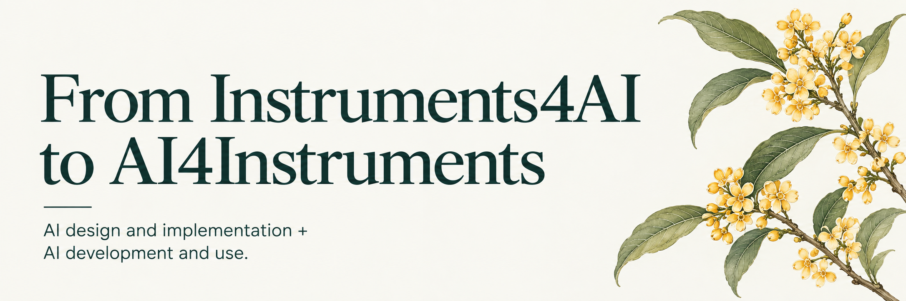
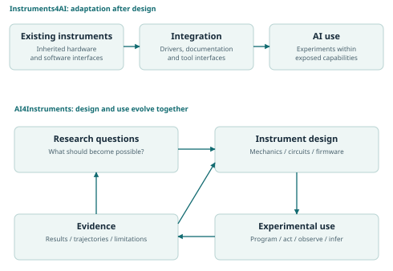
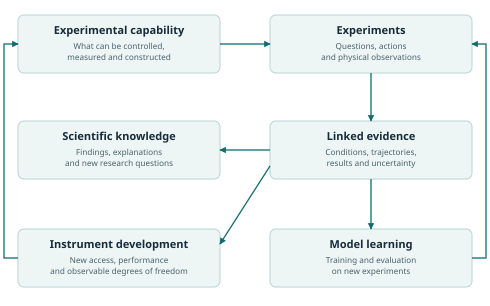

<p>
  
</p>

[Read the paper](paper/manuscript.md) · [PDF](paper/AI4Instruments.pdf) · [Operations](docs/operations.md) · [Try the example](examples/README.md) · [Discuss](https://github.com/Cherish0925/AI4Instruments/discussions/1) · [中文](README.zh-CN.md)

AI4Instruments develops a methodology and an open design framework for AI to participate throughout the life of scientific and engineering instruments: their conception, physical design, manufacture, software development, experimental use and continued improvement.

The purpose is to expand what can be investigated in the physical world, support sustained autonomous research, and make experimental knowledge and capabilities usable across laboratories. **Scientific discovery, the development of instruments, and AI learning from real experimental experience** can advance together. The principles extend across scientific and engineering disciplines, instrument types and computational approaches.

## From using instruments to expanding what can be done

**Instruments4AI** starts with available equipment: establish programmable control, prepare manuals and SDKs, expose tools and knowledge, integrate serial and parallel experiments, and write programmes for new tasks.

**AI4Instruments** carries the question into the apparatus itself: which physical variables should become controllable, which consequences should become observable, and which changes to mechanics, circuits, controllers, firmware or software would enable better experiments?

The connection matters. Experimental use reveals new requirements; instrument development creates new experimental possibilities. AI can participate throughout this cycle, from planning and design to manufacturing, characterisation, research and redesign.

<details>
<summary>Illustration: instrument design and experimental use evolve together</summary>



</details>

## A general method, an expanding set of capabilities

The common structure is **intervention → physical response → observation → the next experimental decision**. It applies at the scale of a component, an instrument, an integrated platform or a collaboration between laboratories. Each scale retains the physical details needed to understand what its operations mean.

AI can take different forms within this structure: language-model agents, perception systems, learned controllers, optimisation methods and combinations of them. The interface should preserve meaning across models and execution environments, while allowing each instrument's capabilities to remain specific and rich.

Three operation roles connect hardware to research:

| Role | What it makes possible |
| --- | --- |
| **Basic Operations** | Elementary control and observation: a complete, inspectable expression of the capabilities at a stated hardware abstraction level. |
| **Standard Operations** | Reusable experimental procedures with accessible implementations, conditions and evidence. |
| **Workflow Operations** | Serial, parallel, continuous and adaptive composition across physical entities, devices, places and times. |

The foundation is **a complete set of basic operations**. An inventory links programmable capabilities to the hardware that implements them and the measurements that characterise them. Research can expand that inventory by revealing unused degrees of freedom, missing observations and opportunities for new hardware.

The roles support direct composition and inspection. A new investigation can reuse, alter or replace an existing procedure, work directly with elementary capabilities, or motivate a different instrument. Capability descriptions state behaviour; evidence records state what was observed; the current research objective supplies the criteria for choosing an experiment. Established workflows remain resources for inquiry.

## From low-level access to cumulative research

Circuits provide a physical route to control and sensing; programmes express how those capabilities are used. Access to controllers, chips, firmware and circuit descriptions lets a research system develop timing, acquisition, actuation and processing beyond the modes anticipated by an earlier application. Mechanics, materials and physical interactions remain part of the same design problem.

Experimental trajectories connect questions, apparatus revisions, interventions, observations, analysis and decisions. They can improve scientific understanding, instrument design, physical models and research strategies. Shared descriptions and evidence can let different laboratories adapt procedures, compare results and combine complementary capabilities.

<details>
<summary>Illustration: how experimental experience develops science, instruments and models</summary>



</details>

## Find your starting point

| Question | Starting point |
| --- | --- |
| What is the central argument? | [From Instruments4AI to AI4Instruments](paper/manuscript.md), [PDF](paper/AI4Instruments.pdf), [Download HTML](paper/AI4Instruments.html?raw=1) |
| How can capabilities be described and composed? | [Operations](docs/operations.md) |
| How does AI participate throughout instrument development? | [Instrument design](docs/instrument-design.md) |
| How do the principles appear in different experiments? | [Illustrative experimental relationships](docs/examples.md) |
| How does this connect to existing research and standards? | [Related work](docs/related-work.md) |
| What would constitute substantive progress? | [Research agenda](docs/research-agenda.md) |
| How can I examine an implementation? | [Executable reference](examples/README.md) |

The repository keeps the argument in `paper/`, technical development in `docs/`, and executable illustrations in `src/` and `examples/`. The examples can grow independently of the scope of the proposal.

## Run the reference

The executable example is a small simulated optical experiment that makes commands, observations, serial and parallel composition, and feedback inspectable. It illustrates the operation model; new implementations can use different apparatus and computational methods.

Python 3.10 or newer is sufficient, with no runtime dependencies or installation:

```bash
python examples/optical_alignment.py --output runs/optical-alignment
python -m unittest discover -s tests -v
```

The run writes a capability manifest, a JSONL trajectory and a result summary. The [example documentation](examples/README.md) explains the model and implementation.

## Develop the project

<details>
<summary>Build the PDF and standalone HTML</summary>

The paper's PDF and HTML are generated from the same manuscript and bibliography. Download the self-contained HTML to read it offline, or share the typeset PDF.

```bash
python -m pip install -r requirements-paper.txt
python scripts/build_paper.py
```

For HTML alone, `python scripts/build_paper.py --html-only` uses only the Python standard library.

</details>

Contributions can include ideas, instrument descriptions, physical designs, controller implementations, new operations, experiments and datasets. The [contribution guide](CONTRIBUTING.md) explains how to connect a contribution to its physical meaning and evidence.

Software is licensed under [MIT](LICENSE); the paper, prose documentation and original figures use [CC BY 4.0](LICENSE-docs.md). See [CITATION.cff](CITATION.cff) for citation information.

---

<sub>Shuxing Yang · [Author’s note](docs/author-note.md) · [Cite](CITATION.cff) · [中文](README.zh-CN.md)</sub>
