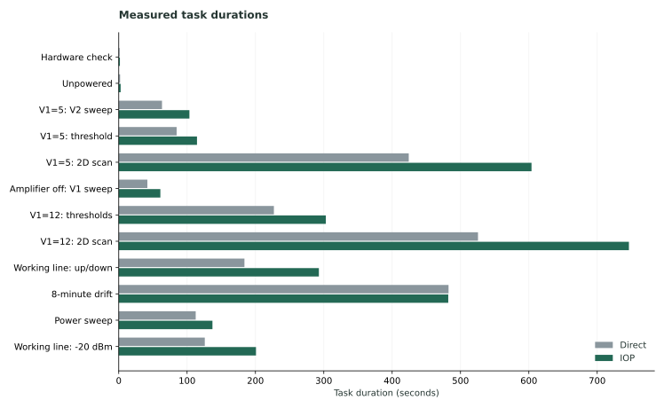
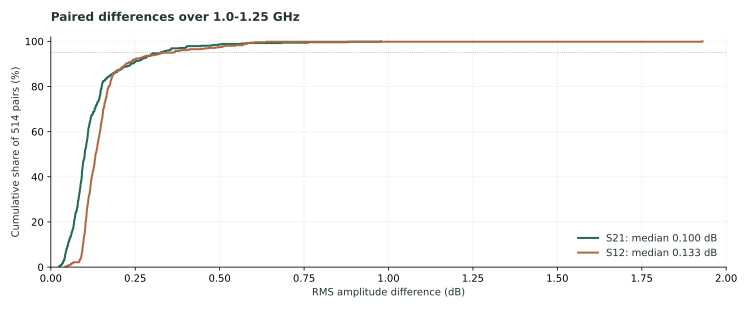
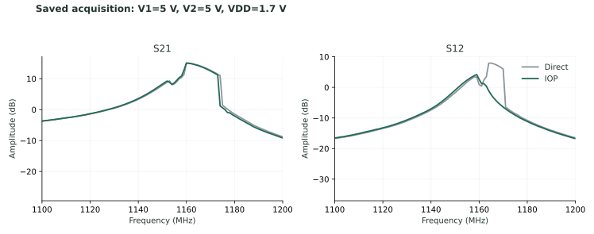

# IOP laboratory feedback analysis

2026-11-05 · IOP Runtime 0.8.4 · Windows 11 · CETC 3672B / GW Instek GPP-4323

[中文](README.zh-CN.md) · [Standalone HTML](report.en.html) · [Original records](https://github.com/Cherish0925/AI4Instruments/releases/tag/lab-feedback-2026-11-05)

## 01 Findings

IOP completed twelve tasks on this physical apparatus. Each implementation saved 514 spectra containing complex S21 and S12. The next priority is **a coherent experiment lifecycle for external research programs, directly connecting operations, instrument state and measurements while avoiding a new experiment for every command.**

| Observation | Recomputed result | Product implication |
| --- | --- | --- |
| Total task duration | Direct: 2,275.0 s; IOP: 3,049.4 s; 34.0% longer | The convenient standalone API has substantial overhead |
| Excluding fixed-duration drift | IOP takes 1.432 times as long | Fixed waits conceal part of the cost of repeated calls |
| Saved measurements | 514 matched pairs; 401 frequency points each | Real instrument access and complete task execution are demonstrated |
| Service history | 19,339 runs and 19,339 operations | Command-level runs fragment the experiment |
| Measurement linkage | All 514 `iop_run_id` fields contain `per-call-runs` | The field cannot identify a real experiment |
| Failed operations | 52, all VNA identity parsing | Receiving a response and interpreting identity need separate states |

The experiment used custom instrument descriptions, the built-in SCPI driver, and the Python/HTTP interface. Desktop, MCP, competing clients, recovery and concurrent platforms were not exercised in these records. Source inspection uses release commit `3b576ee99c4cdd6a9b6df36c7bfb43eee597a8ce`.

## 02 Execution time and workload

These totals come from both `timing.csv` files. Each IOP two-dimensional scan has two entries, which are summed.

| Task | Direct / s | IOP / s | Difference / s | IOP calls |
| --- | ---: | ---: | ---: | ---: |
| Hardware check | 1.3 | 1.7 | 0.4 | 25 |
| Unpowered measurement | 2.0 | 2.8 | 0.8 | 18 |
| V1=5, V2 sweep | 63.3 | 103.4 | 40.1 | 800 |
| V1=5, threshold search | 84.7 | 114.5 | 29.8 | 726 |
| V1=5, 2D scan | 424.3 | 603.9 | 179.6 | 4,013 |
| V1 sweep, amplifier off | 41.9 | 60.9 | 19.0 | 459 |
| V1=12, two threshold searches | 227.0 | 303.0 | 76.0 | 1,942 |
| V1=12, 2D scan | 525.6 | 746.4 | 220.8 | 4,975 |
| Working line, forward/reverse | 183.9 | 292.8 | 108.9 | 2,344 |
| Eight-minute drift | 482.5 | 482.1 | −0.4 | 591 |
| Power sweep | 112.6 | 137.1 | 24.5 | 827 |
| Working line at −20 dBm | 125.9 | 200.8 | 74.9 | 1,556 |
| **Total** | **2,275.0** | **3,049.4** | **774.4** | **18,276** |



### Mechanisms visible in source

Standalone `Client.invoke()` creates a one-step workflow with `submit()`, waits for completion and fetches its result. Each submission copies instrument descriptions and configuration, creates directories and `experiment.json`, then writes `run.json` and registers an artifact on completion. The database occupies 341.5 MB and run files occupy 262.6 MB. Instrument descriptions and configurations alone account for 91.2 MB of the database's run bodies. MB here means decimal megabytes.

The Python client uses `urllib.request`; the server inherits `BaseHTTPRequestHandler`'s HTTP/1.0 default. Connections are not reused by this client. Waiting uses event long polling and repeated run-state reads. **The number of HTTP requests per invocation is not fixed at four.** These are concrete opportunities to improve the call path; this archive does not contain per-request timing.

The timed 18,276 calls took 1,430.8 s in the client, averaging 78.29 ms. The database covers a different population of 19,339 operations: creation-to-start totals 76.132 s and start-to-end totals 565.935 s. Subtracting these aggregates does not isolate network overhead. Operation timing also includes software dispatch and result handling, rather than instrument response alone.

Dividing the total difference by calls gives approximately 42.37 ms per call. This is an allocation of the end-to-end difference, not a measurement of an intrinsic HTTP delay.

### The implementations perform different work

| Stage | Direct program | IOP wrapper | Effect on comparison |
| --- | --- | --- | --- |
| PSU writes | Sleeps 50 ms after each write | No corresponding driver delay | Different waiting time |
| Per-channel read in 2D scans | Reads voltage and current | Also reads setting and output state | Two additional queries here |
| Saving VNA data | Queries channels, traces, frequency axes, sweep settings and identity | Uses known traces and reads the frequency axis plus two complex traces | Direct performs more queries and preserves more settings here |
| Process startup | Task subprocesses using Python 3.10 | Python 3.13; some scans split into segments | Different startup and segmentation costs |
| Drift | Fixed 480-second loop | Same fixed duration | Invocation overhead mostly reduces idle time |

This is a useful comparison of actual user workflows. Isolating Runtime overhead requires one experimental program with interchangeable backends and identical commands, readbacks, waits, acquisitions and saved information.

The archived `compare_iop.py` overwrites repeated step names when loading timing rows. Consequently, its `per_dataset.csv` retains only the last segment's call count for each 2D scan. Its plot uses first-to-last saved-spectrum timestamps, which exclude parts of task execution. The table above uses summed task timers; fitting, plotting and installation are outside these timers.

## 03 Measurement results and acquisition identity

All 514 pairs have exactly matching frequency grids: 0.9–1.3 GHz in 1 MHz increments, with finite complex data. For each pair, amplitude difference in dB is evaluated over 1.0–1.25 GHz and reduced to an RMS; the table summarizes those 514 RMS values.

| Channel | Median / dB | 95th percentile / dB | Maximum / dB |
| --- | ---: | ---: | ---: |
| S21 | 0.1005 | 0.3252 | 0.9765 |
| S12 | 0.1325 | 0.3400 | 1.9299 |



For the working-line fit tables, absolute phase-step differences have median/maximum 0.1005°/0.3542° at −15 dBm and 0.0786°/0.3999° at −20 dBm. These are recomputed comparisons of archived fits, not new fits. IOP ran before direct control. Most paired results are close; attributing the differences to repeatability requires repeated measurements with the same control method.

### An informative discrepant measurement

At V1=5 V, V2=5 V, VDD=1.7 V:

| S12 peak | Direct / dB | IOP / dB |
| --- | ---: | ---: |
| Reading in `index.csv` | 7.93 | 8.08 |
| Peak in saved spectrum | 7.93385 | 4.18580 |



Both programs read two spectra for a stability calculation, then acquire a third spectrum inside the saving function. The `stable` field describes the difference between the first two **S21** peak readings; it does not describe the subsequently saved **S12**. Both sides mark this point `stable=true`. The current records therefore cannot establish that the third acquisition was stable, or assign the discrepancy exclusively to the apparatus or Runtime.

The general improvement is to create an identified acquisition object and use that same object for decisions, plots and saving. An intentional new acquisition gets its own identity, time and conditions.

### Link measurements directly to operations and settings

All 514 direct metadata files contain VNA sweep settings. None of the 514 IOP metadata files contains the `sweep` settings block or full instrument identity. The IOP drift files also omit top-level voltage setpoints, although PSU snapshots remain available. These are differences in the current experiment wrapper's output.

All 19,339 service artifacts are named `experiment.json`. The measurement CSV/JSON files reside outside the service's experiment directories and were not registered as artifacts; `iop_run_id=per-call-runs` is not a real run identifier.

This analysis recovers both channel-operation links for all 514 measurements. Exact float64 trace-content matching against `read_sdata` results is combined with metadata time to disambiguate repeated reads. Each channel has one candidate. See [measurement-operations.csv](measurement-operations.csv). The reconstruction makes this archive usable; the product should create these relationships during acquisition.

## 04 Organizing experiments in the Runtime

Workflows, managed experiment packages, operation records, resource scheduling and streams already exist. Their integration needs to support **one experiment lifecycle shared by external programs and managed packages**.

| Component | Responsibility | Change indicated by these records |
| --- | --- | --- |
| Agent / research program | Scientific goals, strategy, decisions and analysis; missing physical setup information | Use one experiment entry point and retain an existing scientific environment |
| IOP Runtime | Admit work, arrange dependencies and resources, execute and stop, retain progress and results | Allow external programs to start, continue and finish an experiment without creating a run per command |
| Instrument driver / description | Connection, units, commands, completion conditions, readback and hardware acquisition | Keep dependent actions such as trace selection and readout within one device reservation |
| Data and computation | Raw observations, conditions, configuration versions and derived results | Associate files with acquisition, operation and run identifiers |

### Execution location should not determine experiment identity

External Python/TypeScript programs, Agent plugins and managed packages should obtain the same kind of experiment handle. Currently, `Engine.invoke()` requires a running package. That restriction explains the wrapper's standalone one-run-per-command path.

The handle needs a stable run ID, operation IDs, completion/cancellation state and data references. When an external program disconnects, completed physical operations and data remain available. A reconnecting program queries the existing operation instead of resending an action whose outcome is unknown. Managed packages remain useful for unattended execution.

### Reserve resources around meaningful sequences

Another client's trace selection must not occur between selecting and reading a trace. Bias setting, settling and acquisition need the relevant instrument and sample conditions to remain consistent. Independent platforms, independent channels and computation that no longer needs an instrument can proceed concurrently.

The existing scheduler supports device resources and experiment reservations, but every run in this archive has an empty reservation list. Per-command exclusion alone does not preserve the physical meaning of a sequence. Driver-level compound operations or scoped groups should retain ordering, completion semantics and the exact failure position. Batching does not imply concurrent execution.

Fast feedback loops execute close to the instruments. Hardware triggering and clocks provide precise acquisition synchronization. Agents consume meaningful intermediate results and make research decisions. This division extends to scanning, imaging, DAQ, motion, automated chemistry and computational tasks.

### Store each observation and configuration once

Store instrument descriptions and configuration by version and reference those versions from operations. Store a raw response once and let run summaries and events reference it. Large arrays belong in the existing file or stream mechanisms with units, channels, acquisition time and experiment identity. Detailed exports can be generated on demand.

Each side's saved spectrum CSVs occupy approximately 47.5 MB, while IOP's database and run files total 604.1 MB. These stores contain different information, so the ratio is not a measure of pure waste. Repeated descriptions and copies of the same response are directly identifiable duplication.

## 05 Implementation order

These are proposed changes derived from the records and source, not features released by this analysis.

| Order | Change | Resulting behavior |
| --- | --- | --- |
| 1 | External experiment lifecycle and unified SDK | External programs perform multiple operations, attach data and finish under one run; managed packages share the model |
| 2 | Dependent operations and efficient calls | Scoped compound actions, batching, connection reuse and bounded waits for results, preserving the complete experiment record |
| 3 | Acquisition objects and data linkage | Decisions, storage and analysis reference the same acquisition, with real IDs, configuration versions and acquisition conditions |
| 4 | Instrument integration and routine operation | Identity-format handling, source-interface selection, per-device connection handover and explicit experimental dependencies |

The VNA quotes its entire four-field identification response. `csv.reader` produces one field while the parser requires four. Of the 52 failures, 50 belong to background runs named `Instrument identity`; median spacing between failures is about 90 s. Preserve the raw response, support whole-response and per-field quoting, and distinguish unparsed identity from failed communication. Repeated requests to change communication parameters do not address this error.

Multi-interface connections need a configurable local source address. Maintenance should release and reacquire one instrument without stopping the entire laboratory. Scientific dependencies belong to declared experiment environments or package environments; the core service does not need every scientific library preinstalled.

Named operations enforce their declared parameter ranges. Generic `write/query` operations also expose low-level commands, so the current named-operation limits are not an unavoidable device-wide restriction. Normal experiments should use described operations; driver development should retain an explicit low-level interface.

Compare performance using one experimental program with interchangeable backends and identical commands, waits, data and recording. Measure client, scheduling, driver and storage stages for direct control, the current IOP path and the revised path. Windows is the immediate platform of interest; Linux and macOS should also exercise interface behavior and software overhead. Physical results come from the corresponding apparatus.

These records do not establish a need to replace the scheduler with Rust. Remove repeated lifecycles, duplicated data and unnecessary round trips first. Actual stage timings can then guide Rust, native SDK or other implementation work.

## 06 Sources and reproduction

The original ZIP is unchanged. This directory contains analysis, recomputed metrics and recovered measurement links.

| Material | Use |
| --- | --- |
| Archive `README.md` and `IOP_vs_direct_report_20261105.md` | Experimenter's account and initial interpretation |
| Both `data_band2/timing.csv` files | Full task times, summing segmented tasks |
| 514 CSV/JSON pairs per implementation | Raw complex data, grids, setpoints and metadata |
| Both sets of `*_params.csv` | Comparisons of existing fitted parameters |
| `iop/service_home/records.sqlite3` | Operations, runs, events, artifacts and configuration versions |
| `direct/scripts/` and `iop/scripts/` | Actual command, wait and acquisition sequences |
| [client.py](https://github.com/Cherish0925/AI4Instruments/blob/3b576ee99c4cdd6a9b6df36c7bfb43eee597a8ce/src/ai4instruments/iop/client.py), [engine.py](https://github.com/Cherish0925/AI4Instruments/blob/3b576ee99c4cdd6a9b6df36c7bfb43eee597a8ce/src/ai4instruments/iop/engine.py) | Per-call runs, package-only invocation, recording and resources |
| [drivers.py](https://github.com/Cherish0925/AI4Instruments/blob/3b576ee99c4cdd6a9b6df36c7bfb43eee597a8ce/src/ai4instruments/iop/drivers.py), [identification.py](https://github.com/Cherish0925/AI4Instruments/blob/3b576ee99c4cdd6a9b6df36c7bfb43eee597a8ce/src/ai4instruments/iop/identification.py) | Connections, identity parsing and repeated identification |
| [server.py](https://github.com/Cherish0925/AI4Instruments/blob/3b576ee99c4cdd6a9b6df36c7bfb43eee597a8ce/src/ai4instruments/iop/server.py), [Python HTTP documentation](https://docs.python.org/3.13/library/http.server.html#http.server.BaseHTTPRequestHandler.protocol_version), [urllib documentation](https://docs.python.org/3.13/library/urllib.request.html#urllib.request.urlopen) | HTTP protocol and connection behavior |

[findings.json](findings.json) contains aggregates, [spectra.csv](spectra.csv) all 514 paired comparisons, and [measurement-operations.csv](measurement-operations.csv) the recovered operation links.

Recompute with Python 3.11+ and NumPy:

```sh
python analyze.py IOP_vs_direct_records_20261105.zip --output results
```

The analyzer reads ZIP, CSV, JSON and SQLite. It does not import or run the archived instrument-control programs. It verifies that the input matches the linked published archive. `build_report.py` generates the figures and standalone Chinese/English HTML reports.
