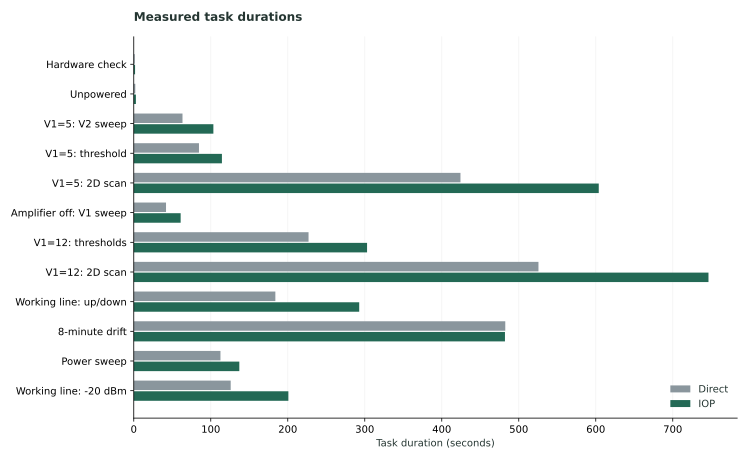
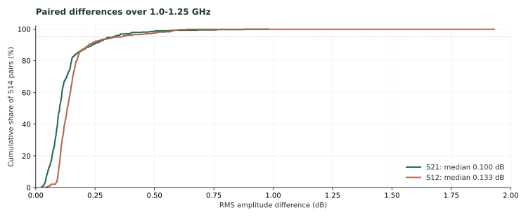
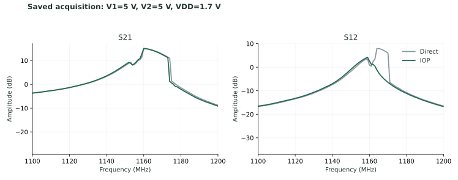

# IOP 实验反馈分析

2026-11-05 · IOP Runtime 0.8.4 · Windows 11 · CETC 3672B / GW Instek GPP-4323

[English](README.md) · [独立 HTML](report.zh-CN.html) · [原始记录](https://github.com/Cherish0925/AI4Instruments/releases/tag/lab-feedback-2026-11-05)

## 01 结论

IOP 在这套真实实验平台上完成了十二项任务，两组各留下 514 份双向复数谱。下一轮最需要解决的是：**让外部研究程序自然地拥有一个完整实验，把操作、仪器状态和测量文件连在一起，并减少每条命令重复创建实验的开销。**

| 观察 | 重新计算的结果 | 对产品的意义 |
| --- | --- | --- |
| 十二项任务用时 | 直连 2,275.0 s；IOP 3,049.4 s，增加 34.0% | 当前最容易使用的调用路径有明显额外开销 |
| 扣除定长漂移任务 | IOP 用时为直连的 1.432 倍 | 需要改善连续调用；定长等待会掩盖开销 |
| 保存的测量 | 两组各 514 份，全部成功配对；每份 401 个频点 | 真实仪器接入和完整任务执行已经有实测支持 |
| 服务记录 | 19,339 个 run、19,339 个 operation | 每条命令成为一个实验，实验层次被拆散 |
| 测量与实验的关联 | 514 份元数据的 `iop_run_id` 全为 `per-call-runs` | 文件无法通过这个字段找到真实实验 |
| 失败操作 | 52 次，全部是矢网身份解析失败 | 通信成功与身份解析成功需要分别表达 |

这次使用的是自定义设备说明、内置 SCPI 驱动和 Python/HTTP 客户端。桌面界面、MCP、多客户端竞争、断线恢复和多平台并发没有在这份实验记录中运行。源码分析针对发布时的提交 `3b576ee99c4cdd6a9b6df36c7bfb43eee597a8ce`。

## 02 用时：先把工作量和调用方式分清楚

下表从两份 `timing.csv` 重新汇总。IOP 两个二维扫描各有两行，按步骤合并。

| 步骤 | 直连 / s | IOP / s | 增加 / s | IOP 调用数 |
| --- | ---: | ---: | ---: | ---: |
| 自检 | 1.3 | 1.7 | 0.4 | 25 |
| 不加电测量 | 2.0 | 2.8 | 0.8 | 18 |
| V1=5，扫描 V2 | 63.3 | 103.4 | 40.1 | 800 |
| V1=5，阈值搜索 | 84.7 | 114.5 | 29.8 | 726 |
| V1=5，二维扫描 | 424.3 | 603.9 | 179.6 | 4,013 |
| 放大器关闭，扫描 V1 | 41.9 | 60.9 | 19.0 | 459 |
| V1=12，两条阈值搜索 | 227.0 | 303.0 | 76.0 | 1,942 |
| V1=12，二维扫描 | 525.6 | 746.4 | 220.8 | 4,975 |
| V1=12，工作线正反扫描 | 183.9 | 292.8 | 108.9 | 2,344 |
| 8 分钟漂移 | 482.5 | 482.1 | −0.4 | 591 |
| 功率扫描 | 112.6 | 137.1 | 24.5 | 827 |
| −20 dBm 工作线扫描 | 125.9 | 200.8 | 74.9 | 1,556 |
| **合计** | **2,275.0** | **3,049.4** | **774.4** | **18,276** |



### 已能定位的开销

外部程序的 `Client.invoke()` 调用 `submit()` 新建单步工作流，再等待 run 完成、读取结果。每次提交会复制仪器说明和配置，创建目录、写入 `experiment.json`，结束时再写 `run.json` 并登记附件。数据库与 run 文件分别占 341.5 MB、262.6 MB；其中仅数据库 run 正文中的两份仪器描述就占 91.2 MB。这里的 MB 均为十进制单位。

Python 客户端使用 `urllib.request`；HTTP 服务沿用 `BaseHTTPRequestHandler` 的默认 HTTP/1.0。当前客户端没有复用连接。等待过程通过事件长轮询返回，还会再次读取 run 状态，**一次调用的请求数不是固定四次**。这些都是可以改善的具体机制，但本包没有逐请求的耗时记录。

计时程序记录的 18,276 次调用共用 1,430.8 s，平均 78.29 ms。数据库统计的是更大的 19,339 次操作：创建到开始合计 76.132 s、开始到结束合计 565.935 s。两者不能直接相减得出准确的网络耗时。操作时间还包含软件调度和结果处理，并非纯粹的仪器响应时间。

`774.4 s / 18,276 ≈ 42.37 ms` 只是这次整套任务差值按调用数分摊的结果，不能当作 HTTP 固有延迟。

### 两套程序也存在工作量差异

| 环节 | 直连程序 | IOP 封装 | 比较时的影响 |
| --- | --- | --- | --- |
| 电源写入 | 每次写入后等待 50 ms | 内置写入没有这段等待 | 等待时间不同 |
| 二维扫描中的电源读数 | 单通道读取 V、I | 单通道读取 V、I、设定值、输出状态 | IOP 在这里多读两个量 |
| 保存矢网数据 | 查询通道、轨迹、频率轴、扫描配置和身份 | 使用已知轨迹，读取频率轴和两条复数谱 | 直连在这里查询更多，并保存更多设置 |
| 程序启动 | 每个任务启动脚本子进程，Python 3.10 | IOP 环境 Python 3.13；部分扫描分段调用 | 启动方式、解释器和分段成本不同 |
| 定长漂移 | 480 s 的周期循环 | 同样为 480 s | 调用额外耗时主要挤占循环等待 |

因此，这是一组有价值的端到端使用比较。若要精确测量 Runtime 的额外成本，应让同一份实验程序只替换调用后端，保持命令、读回、等待、采集和保存内容相同。

归档中的 `compare_iop.py` 用字典覆盖同名步骤，导致 `per_dataset.csv` 的二维扫描调用数只保留后一段；它用首末谱时间差画耗时图，也不等于完整任务用时。本分析使用 `timing.csv` 的合并值。上表没有把后续拟合、绘图或安装时间算入实验用时。

## 03 测量：结果相近，还需要保留采集关系

514 对谱的频率轴逐点相同，均为 0.9–1.3 GHz、间隔 1 MHz；复数数据全部为有限值。以下对每一对谱计算 1.0–1.25 GHz 范围内的幅度 dB 差 RMS，再对 514 个 RMS 取统计量。

| 通道 | 中位数 / dB | 95 分位 / dB | 最大值 / dB |
| --- | ---: | ---: | ---: |
| S21 | 0.1005 | 0.3252 | 0.9765 |
| S12 | 0.1325 | 0.3400 | 1.9299 |



工作线拟合表中的相位步差，−15 dBm 时中位数 0.1005°、最大值 0.3542°；−20 dBm 时中位数 0.0786°、最大值 0.3999°。这些数值来自归档拟合表的重新比较，没有重新拟合。两组先后运行，IOP 在前、直连在后；现有数据支持“大部分配对结果接近”。要把差异归因于测量重复性，还需要同一控制方式下的重复测量分布。

### 一个值得保留的异常点

在 V1=5 V、V2=5 V、VDD=1.7 V 的点上：

| S12 峰高 | 直连 / dB | IOP / dB |
| --- | ---: | ---: |
| `index.csv` 中的读数 | 7.93 | 8.08 |
| 最终保存谱中的读数 | 7.93385 | 4.18580 |



源码解释了为什么这两行可以不同：两套程序先读两次谱计算稳定性，再在保存函数里读取第三次谱。`stable` 根据前两次 **S21** 峰高差计算，并不描述后来保存的 **S12**。这个点两侧都标成 `stable=true`，不能据此认定第三次采集也稳定，更不能仅凭这组结果断定差异一定由器件或一定由 Runtime 引起。

适用于其他实验的改进是：一次采集生成明确的数据对象，后续判断、绘图和保存引用同一个对象；确实需要再次采集时，产生新的采集编号并保留时间与条件。

### 原始谱、设置和操作应有直接关联

514 份直连元数据都保存了矢网扫描设置；IOP 侧 514 份都没有 `sweep` 设置块，也没有完整仪器身份字段。漂移数据还缺少顶层的三个设定值字段，但保留了电源快照。这些是当前封装的保存内容差异。

IOP 数据库的 19,339 个附件全部名为 `experiment.json`。实际测量 CSV/JSON 存在外部目录，没有作为实验附件登记；`iop_run_id=per-call-runs` 也不是实际 run ID。

本次已经恢复了全部 514 份文件与两个通道操作的对应关系：将保存的复数数组与数据库 `read_sdata` 返回值进行完全一致的 float64 内容匹配，再用文件时间消除重复读数的歧义，每个通道均得到唯一候选。结果见 [measurement-operations.csv](measurement-operations.csv)。这给本次记录补上了可用的关联，后续产品应在采集时直接生成这些关系。

## 04 Runtime 应怎样组织实验

当前已经有工作流、实验程序包、逐操作记录、资源调度和数据流。需要完善的是这些功能之间的连接，尤其是**外部程序与内部托管程序应共享同一种实验生命周期**。

| 层次 | 应承担的工作 | 这次反馈指出的改进 |
| --- | --- | --- |
| Agent / 研究程序 | 研究目标、实验策略、条件判断、分析方法；补齐实际接线和初始设置 | 使用一个实验入口；能够继续调用原有科学计算环境 |
| IOP Runtime | 接受实验、安排依赖和资源、运行与停止、保存进度和结果 | 支持外部程序开始/继续/结束实验，无需每次命令新建 run |
| 仪器驱动 / 仪器说明 | 连接方式、单位、命令、完成条件、读回、硬件采集 | 将“选轨迹并读取”等连续操作放在同一设备占用期间 |
| 数据与计算 | 原始数据、采集条件、仪器配置版本、处理结果及其来源 | 文件与采集编号、operation ID、run ID 直接关联 |

### 一个实验，可从不同地方驱动

外部 Python/TypeScript 程序、Agent 插件以及 Runtime 托管程序包都应取得同一种实验句柄。程序在哪里运行，不应决定它能否拥有连贯的实验记录。现有 `Engine.invoke()` 只接受运行中的 package；这是本次封装只能逐条提交单步 run 的根本接口原因。

实验句柄需要包含稳定的 run ID、逐操作 ID、完成/取消状态和数据引用。外部程序断开后，已经完成的物理操作和数据继续保留；重新连接时查询原操作状态，不自动重发结果未知的物理动作。长期无人值守任务仍可交给 Runtime 托管。

### 同步范围与实际仪器状态一致

串行化应覆盖相互影响的操作。例如“选择轨迹 → 读取该轨迹”之间不能插入另一个客户端的轨迹切换；“设定偏压 → 等待稳定 → 采集”需要保持涉及的仪器与样品条件。独立平台、独立通道和不占用仪器的数据处理可以并行。

现有调度器已支持设备资源与实验资源预留，本次所有 run 的预留列表为空。逐命令互斥不自动保证一组命令的物理意义完整。应通过驱动中的组合操作或带资源范围的步骤组表达它，批量提交也必须保留顺序、完成条件和失败位置。

高速反馈循环靠近仪器执行；硬件触发和硬件时钟负责需要精确同步的采集。Agent 接收阶段结果并作研究决策。这样可同时适用于扫描、成像、DAQ、运动控制、自动化化学和计算任务。

### 记录保留必要信息，避免重复复制

仪器说明和配置按版本保存，操作引用使用的版本；原始返回值保存一次，实验汇总和事件引用它。大数组使用现有文件或流机制，配上单位、通道、采集时间和实验编号。详细导出可以按需生成，逐次复制整份设备说明没有必要。

这次每侧原始谱 CSV 约 47.5 MB，而 IOP 数据库与 run 文件合计 604.1 MB。两者包含的内容不同，不能把这个比例当作净浪费；已能直接确认的重复项包括仪器描述和多个位置保存的同一返回值。

## 05 下一轮实现顺序

以下为由这次记录和源码提出的实现安排，尚未作为新版本发布。

| 顺序 | 改动 | 完成后的具体行为 |
| --- | --- | --- |
| 1 | 外部实验生命周期与统一 SDK | 外部程序自然地在一个 run 下执行多次操作、保存文件和结束实验；已有程序包使用同一模型 |
| 2 | 连续操作与调用效率 | 支持保持设备占用的组合操作、批量提交、连接复用及带限时等待的结果返回；实验记录保持完整 |
| 3 | 采集对象与数据关联 | 一次采集可直接用于判断、保存和计算；结果携带真实 run/operation ID、配置版本和采集条件 |
| 4 | 仪器接入与日常使用 | 正确处理身份回复格式、网卡选择、单台设备连接交接和实验依赖；人和 Agent 都能读取完整参数说明 |

身份处理已有可复现的问题：该矢网将整条四字段回复包在一对引号里，`csv.reader` 得到一个字段，当前解析器要求四个字段而失败。52 次失败中有 50 次来自名为 `Instrument identity` 的后台工作流；失败间隔中位数约 90 s。应保存原始回复，兼容整串引用与逐字段引用，并把“回复已收到但未解析”与“通信失败”分开，避免反复要求修改通信参数。

多网卡连接应能声明本机源地址。维护时应能单独释放一台仪器并重新接管，不必停止整个实验室。科学计算依赖放在实验环境或程序包环境中，Agent 可声明所需库；不必把每一种科学软件都装进核心服务。

参数范围继续由仪器说明和平台设置表达。当前命名操作的范围检查确实有效，但通用 `write/query` 也可发送底层命令；它们不能被描述为整个设备不可绕过的限幅。常规实验使用具名操作，驱动开发保留明确的底层入口。

性能改动用同一实验程序的可替换后端比较：保留相同命令、等待、返回数据和保存内容，记录调用、调度、驱动和保存各段耗时。原来的直连方式、现有 IOP 方式和改进方式都保留结果。Windows 是本次重点，Linux/macOS 同时检查接口行为与软件开销；真实仪器结果由对应实验平台补充。

这份记录尚不能决定是否需要把调度器迁移到 Rust。优先消除生命周期重复、重复数据和多次网络往返，随后用实际分段耗时决定哪些部分值得用 Rust、原生 SDK 或其他实现优化。

## 06 来源与重算

原始压缩包保持不变。本目录只保存分析、重新计算的指标和测量关联。

| 材料 | 用途 |
| --- | --- |
| 原包 `README.md`、`IOP_vs_direct_report_20261105.md` | 实验者描述、条件与初步结论 |
| 两侧 `data_band2/timing.csv` | 完整任务用时；同名分段相加 |
| 两侧 514 个 CSV/JSON 对 | 原始复数谱、频率轴、设定值与元数据比较 |
| 两侧 `*_params.csv` | 已有拟合参数的配对比较 |
| `iop/service_home/records.sqlite3` | 全部操作、实验、事件、附件和配置版本 |
| `direct/scripts/`、`iop/scripts/` | 解释实际查询、等待和采集顺序 |
| [client.py](https://github.com/Cherish0925/AI4Instruments/blob/3b576ee99c4cdd6a9b6df36c7bfb43eee597a8ce/src/ai4instruments/iop/client.py)、[engine.py](https://github.com/Cherish0925/AI4Instruments/blob/3b576ee99c4cdd6a9b6df36c7bfb43eee597a8ce/src/ai4instruments/iop/engine.py) | 单步 run、package 调用限制、记录与资源机制 |
| [drivers.py](https://github.com/Cherish0925/AI4Instruments/blob/3b576ee99c4cdd6a9b6df36c7bfb43eee597a8ce/src/ai4instruments/iop/drivers.py)、[identification.py](https://github.com/Cherish0925/AI4Instruments/blob/3b576ee99c4cdd6a9b6df36c7bfb43eee597a8ce/src/ai4instruments/iop/identification.py) | SCPI 连接、身份解析与重复识别 |
| [server.py](https://github.com/Cherish0925/AI4Instruments/blob/3b576ee99c4cdd6a9b6df36c7bfb43eee597a8ce/src/ai4instruments/iop/server.py)、[Python HTTP 文档](https://docs.python.org/3.13/library/http.server.html#http.server.BaseHTTPRequestHandler.protocol_version)、[urllib 文档](https://docs.python.org/3.13/library/urllib.request.html#urllib.request.urlopen) | HTTP 版本与连接行为 |

[findings.json](findings.json) 包含汇总；[spectra.csv](spectra.csv) 包含全部 514 对谱的比较；[measurement-operations.csv](measurement-operations.csv) 包含恢复的操作关联。

使用 Python 3.11+ 和 NumPy 重算：

```sh
python analyze.py IOP_vs_direct_records_20261105.zip --output results
```

分析程序只读取 ZIP、CSV、JSON 和 SQLite，不导入或运行原包中的仪器控制脚本。它同时检查输入包是否与上述发布记录一致。图表和中英文 HTML 可由 `build_report.py` 生成。
