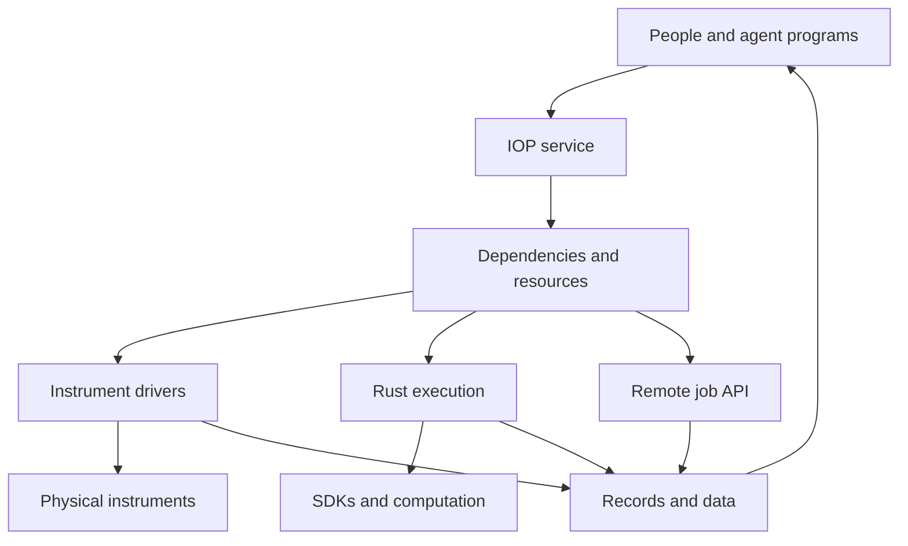

# IOP Runtime architecture

[中文](architecture.zh-CN.md) · [Installation](README.md) · [Execution](../../iop/execution.md) · [Extensions](../../iop/software.md)

0.8.0 adds [MCP and agent integration](../../iop/agent-setup.md), a shared laboratory context and instrument configuration recovery. [Application interfaces and system support](../../iop/product.md).

IOP Runtime runs on laboratory computers between people, agents, experiment programs and their instruments or computational tools. A computer may manage several experimental platforms. Platform definitions describe device membership, physical connections, shared objects and initialization.

## Implementation in 0.8.0

| Component | Responsibility | Source |
| --- | --- | --- |
| Python service | HTTP, platform configuration, dependency/resource scheduling and adapters | `src/ai4instruments/iop/` |
| Rust executor | SDK sessions, program process trees, cancellation and exit | `iop/daemon/` |
| TypeScript client | Package submission, operations, events, results and files | `iop/clients/typescript/` |
| Desktop and browser | Registration, topology, experiments, results and native/browser switching | `desktop.py`, `ui/` |
| SQLite and files | Run state, operations, events, configuration revisions, file index and raw output | `store.py` and the service directory |

The browser uses static HTML and JavaScript served by IOP; it needs no separate Node.js service. Vendor C, C++, C# and Java SDKs use independent worker processes. Ordinary programs can use the command adapter.

## Scheduling

Submission checks dependencies, arguments and resource requests, saves the definition, and returns a run identifier. Dependency counts and successor lists are built once. Completion updates the affected successors; ready operations rotate between experiments without repeatedly traversing the entire graph.

One scheduler decides allocation while workers and independent processes perform I/O. Devices have capacity one by default; a capable driver declares `concurrency`. Shared objects and counted computation resources use the same allocation model. A request acquires its complete quantities together and releases them after execution. An experiment reservation covers its internal operations without counting them twice.

`after` expresses ordering and `bindings` transfers results into arguments. Wiring, shared objects and experiment dependencies remain distinct. Instrument clocks, controllers and hardware triggers implement precise timing.

## Processes and drivers

The `process` interface maintains an SDK session using JSON lines, forwarding identified requests, progress and results. Devices on one SDK or bus can share a worker. The `command` adapter runs ordinary executables with operation-specific inputs and output files. Rust also supervises experiment packages.

Linux and macOS use process groups; Windows uses Job Objects. Normal completion, cancellation, timeout and parent disconnection end the supervised program's descendants. Existing direct Python drivers keep their call interface; SDKs requiring independently terminable execution use `process`.

The HTTP job adapter submits a job, retains its identifier and follows status until the remote service confirms an outcome. It can also call another IOP instance. Each instance schedules its own resources; upper-level experiment programs organize cross-host dependencies.

## Long-running work and data

Completed package operations are kept in SQLite; memory retains only the package's unfinished calls. Workflows retain results needed by subsequent steps until completion. Event requests can wait for new records; operation history has cursor-based pagination.

SQLite stores structured records. Images, waveforms and arrays are files. Uploads and downloads stream in chunks and program output is written directly to files. The release adds a file-name index while preserving existing records.

Restart preserves queued work and marks previously active experiments interrupted with their recorded results intact. Loss of a driver or inability to determine a remote job's outcome records the unresolved action and affected resources until the equipment state is established. Program state and physical state are represented separately.

## Extensions and maintenance

New devices normally add a description or adapter package. The service supplies common execution behavior; drivers retain domain-specific operation semantics. Python packages publish `ai4instruments.drivers` entry points. Other languages implement the independent program interface. `iop adapters` lists installed entries and `iop reconnect` re-establishes existing driver connections.

HTTP and workflow scheduling currently run in Python; Rust handles process execution. Further migration should follow measured communication, storage and scheduling costs. `scripts/benchmark_iop.py` reproduces the [local scheduling measurements](../../iop/performance/README.md).
