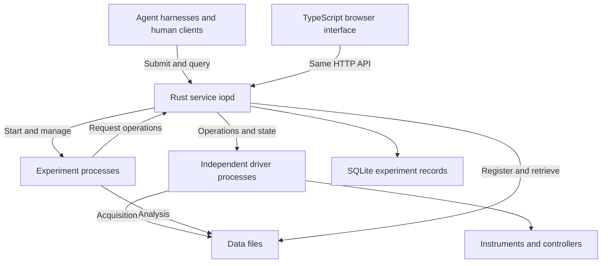

# IOP runtime architecture

[中文](architecture.zh-CN.md) · [Install and use](README.md) · [IOP design](../iop.md) · [Current HTTP API](http-api.md)

**One experimental platform, one persistent instrument service.** People and agents submit experiment programs. The service maintains device connections, schedules operations and preserves the experiment. Runs can last hours or days independently of the submitting terminal, browser or agent session.

The target implementation uses **a Rust core, Python driver and experiment processes, TypeScript interfaces and clients, and SQL experiment records**. This document establishes that architecture and its implementation sequence. The installable **0.3.0 release uses a Python core and SQLite**; section 8 compares the implementation with the target.

## 1. The service within IOP

IOP has four components: **instrument descriptions, a persistent service, experiment programs and experiment records**. This document designs the service and its connections to the other components. The four technologies divide implementation responsibilities; they do not define four protocols.

Instrument descriptions retain principles, quantities, units, methods, parameters, completion conditions and device-specific behavior. Experiment programs express research methods, conditions, loops and analysis. The service executes operations and preserves records. One instrument and an integrated experimental platform use the same organization.

`iopd` names the target daemon. It manages multiple processes while presenting one entry point. Experiment programs route instrument access through it. Adapters can connect existing EPICS, SiLA or other control systems; each integration must establish who actually controls the device.

## 2. Technology responsibilities

| Technology | Responsibility | Reason and deployment |
| --- | --- | --- |
| **Rust** | API, device registration, task states, dependencies and resources, driver supervision, stopping and recovery | Keep the persistent core small. Types and ownership help reduce concurrency and memory errors. Tokio provides asynchronous connections and messaging.[1][2] |
| **Python** | Instrument adapters, vendor SDKs, experiment methods, scientific computation and analysis | Preserve existing drivers and scientific libraries. Drivers and experiments run in separate processes; incompatible SDK dependencies can use different environments. |
| **TypeScript** | Browser interface, TypeScript client and appropriate agent integrations | Share structured types across clients and interface code. Serve the compiled static interface from the daemon; the core requires neither Node.js nor a browser. |
| **SQL / SQLite** | Durable runs, operations, events, parameters, versions and file references | Default to a local database without a separate database server. Store large images, waveforms and video as files with descriptions and relationships in SQL. |

Python can handle many tasks waiting for instruments. In conventional CPython, the GIL primarily limits parallel execution of Python bytecode across threads; separate processes and some native computation libraries behave differently. Free-threaded builds exist, but vendor extensions require compatibility checks.[3][4]

Rust concentrates persistent execution, explicit state transitions and process supervision in the core. Python workers retain the work suited to their ecosystem. Wrapping a synchronous SDK call in an asynchronous Rust function does not make it interruptible: a started Tokio `spawn_blocking` task cannot be stopped with `abort`.[5]

This division suits the project’s long-term goals and adds process communication, interface versioning and packaging work. Preserve the existing experiment interface while replacing the core in stages; measure performance benefits using the same workloads.

C, C++, C# and Java SDKs can use independent adapter processes written in those languages. They remain device-specific optional dependencies. SQL is a data language; SQLite is the default database implementation here.

## 3. Serial execution, concurrency and resource ownership

Three relationships need separate representation: **program dependencies, communication order and physical resource occupancy**. Sending a temperature command is quick; stabilizing the sample may take minutes. Releasing a communication connection does not make the sample available to another experiment.

| Situation | Scheduling behavior |
| --- | --- |
| Several agents submit experiments | Accept independently and return run identifiers; schedule by resources and available capacity. |
| Independent instruments | Run concurrently once their dependencies are complete. |
| Commands and replies on one instrument | Execute in order by default; allow concurrent channels only when the driver explicitly supports them. |
| Shared serial bus, controller or non-thread-safe SDK | Represent the shared resource and order access according to its actual restrictions. |
| Different devices affect one sample, optical path, vessel or mechanical region | Declare the physical resource and retain it across the relevant steps. |
| High-rate acquisition or precise synchronization | Configure acquisition and triggering through the service; device clocks, controllers or FPGAs execute precise timing. |

A single state-management task decides resource ownership. Device communication proceeds through separate execution paths, allowing concurrent operations while keeping allocation decisions consistent.

1. Persist the accepted definition and parameters before returning a run identifier. The same request identifier retrieves the original submission; conflicting content is rejected.
2. Build dependencies and resource sets. Dispatch only when predecessors have completed, resources are available and the driver has capacity.
3. Acquire each required set together. Waiting work holds no partial set. Experiment-declared reservations retain resources across the relevant steps.
4. Order competing requests by acceptance time while unrelated resources continue. Later conflicting requests cannot repeatedly bypass an earlier waiting request.
5. Persist the operation start before sending it to the driver. Drivers report progress, readings and completion. A database transaction cannot include a physical action; recovery must handle interruption between recording and execution.
6. Persist the result once the completion condition is met, release the appropriate resources and advance dependent work. For cancellation and timeout, retain the request, driver response and actual device state separately.

Begin with conservative exclusive resources. Refine independent channels, shared reads or finite capacity only where instrument descriptions support them; even a read command can occupy a communication connection. Declare resources needed across steps before starting that section, avoiding experiments that each hold one resource while waiting for the other.

Bound request queues, driver queues and data buffers. When full, return an explicit retry response and preserve capacity for status and stop requests. Device capabilities, buses, CPU, memory and storage jointly determine useful concurrency. Adaptive scheduling adjusts software task capacity within those limits without changing physical restrictions or sampling requirements.

### A complete example

Materials experiment A uses a temperature stage, source meter, camera and sample A. It reserves these resources, then heats the sample and configures the meter and camera concurrently. Once temperature is stable and both instruments are ready, hardware triggering coordinates acquisition. A computation process analyzes the files and stores fitted results linked to the original data.

Meanwhile, experiment B can use an independent balance and sample B. Experiment C, which needs the same temperature stage, waits for A to release it. If the camera and balance share a communication device that allows only sequential access, both experiments also declare that communication resource.

Concurrency follows dependencies and physical resources. Additional threads cannot accelerate thermal settling or place one sample in two incompatible conditions.

## 4. Driver processes and continued execution

Group driver processes according to devices, shared buses and SDK requirements. A bus with several addresses can have one owning process; unrelated vendor SDKs can run separately. Each device connection has an explicit owner.

The core exchanges numbered messages with drivers: describe, connect, execute, read state, stop and close. Messages carry operation identifiers, parameters and reported completion state. Standard output can carry structured messages while a separate channel carries logs; the initial driver-process implementation will fix the local transport.

Experiment programs may be service-managed processes or connected clients. All instrument operations return to the service for scheduling. CPU-intensive analysis uses computation processes rather than core request-handling threads. A vendor SDK crash should terminate only its own process.

**Ending a client wait, stopping a software process and stopping a physical action are separate events.** After a timeout, the service retains actions and data already produced; the driver reports whether the action stopped. A process exit does not prove that motion, heating or acquisition has stopped. Resources with unresolved physical state remain unavailable for reassignment while independent equipment continues.

On restart, read unfinished records, reconnect and obtain device state. Attach confirmable outcomes to the original operation. Mark unresolved outcomes and require device-specific recovery or an operator decision. Request deduplication prevents duplicate acceptance; it does not by itself establish exactly-once physical execution.

## 5. Data and experiment records

Each run retains program and description versions, parameters, device configuration, operation order, state changes, raw readings, derived results and file references. Acquisition timestamps identify their clock source, with synchronization information where relevant.

SQLite is the local default. WAL allows concurrent reading and writing, but still permits only one writer at a time; keep the database on the service computer's local disk.[6] A dedicated storage task submits short transactions so database waits do not block scheduling. Acknowledge acceptance only after critical records, including the run definition, have committed.

Images, waveforms and video use separate transfer and file-writing paths. Acquisition workers write chunks; the service registers completed chunks, formats and associated operations. Interface previews may be downsampled. Whether raw acquisition may drop frames must be explicit in the experiment definition. When storage cannot keep up, reduce a configurable rate, pause or end acquisition as supported by the device, and record any actual losses.

Add aggregation or a PostgreSQL storage implementation when cross-computer querying requires it. Multiple daemons do not share a SQLite file on a network filesystem, nor does a shared database authorize simultaneous control of one instrument.

## 6. Integration with agent harnesses

A stable, language-independent machine API is the principal entry point. Python and TypeScript SDKs, CLI, browser and MCP adapters use it. MCP can provide discovery and invocation; IOP retains experiment state, scheduling and files.

| Interface information | What an agent can obtain directly |
| --- | --- |
| Instrument descriptions | Operations, parameter structures, units, conditions, completion semantics and explanatory materials. |
| Submission and deduplication | Run identifier, acceptance state, request identifier and definition versions. |
| Progress and results | Operation states, structured errors, readings, results and file locations. |
| Continued connection | Ordered events and a cursor for retrieving events after reconnection. |
| Stop and continuation | Whether stopping took effect, actual equipment state and steps eligible to continue. |

A harness first connects to an existing service, or helps install and start one when absent. Multiple harnesses share the platform service. Closing a harness neither shuts down the service nor automatically cancels accepted experiments. Model providers and network sessions can change independently of local equipment connections and records.

HTTP JSON preserves the current `/v1` interface. Python and future TypeScript clients share versioned message definitions. Existing event polling remains usable, followed by resumable event delivery. Define operation states, units, errors and compatibility before generating client types. Replacing the core language should not require rewriting experimental methods.

## 7. Installation and operating systems

The target deliverable is an installer for each supported OS and CPU architecture, containing `iopd`, the static interface, configuration and selected driver environments. Running the core requires neither a Rust compiler nor Node.js. Python drivers use bundled or separately managed Python environments.

| Target system | Service integration and device access |
| --- | --- |
| Windows | Native service; SDKs matching the OS and CPU architecture. |
| Linux | systemd system or user service; device access configured for that installation. |
| macOS | LaunchDaemon or LaunchAgent as appropriate; matching SDK architecture. |
| WSL | Linux build with devices exposed to WSL; Windows-specific SDKs remain with a Windows service. |

Publish support separately for **core execution, device discovery, driver connection and verified operations**. Discovering a USB device, serial port or network address must be followed by matching an instrument description and usable driver. A Windows-only vendor SDK does not acquire macOS support when the core changes to Rust.

Complete the single-computer execution path first. Multi-computer platforms subsequently add remote driver connections and disconnection handling while maintaining one controlling authority per instrument. Coordination across independent platforms is a separate extension.

## 8. Current implementation and development sequence

| Component | Implemented in 0.3.0 | Target change |
| --- | --- | --- |
| Persistent core | Python scheduler thread, device thread pool, per-request HTTP threads | Rust asynchronous API, independent state management and bounded queues. |
| Drivers | Python drivers invoked in the service process | Independent processes with explicit connection ownership. |
| Experiment programs | Separate processes, dependencies and reservations across steps | Preserve program packages and resource semantics; extend recovery and capacity management. |
| Data | SQLite, events, results and files | Dedicated storage task, large data streams, chunked files and complete version relationships. |
| Clients | Python, HTTP, CLI, HTML/CSS/JavaScript interface | TypeScript SDK and compiled interface, event delivery and optional MCP integration. |
| Interruption | Started runs become interrupted; records remain | Read device state to resolve unfinished operations before further execution. |
| Installation | Python required; scripts and login startup | OS-specific packages, managed driver environments and native service management. |

The implementation lives in [`src/ai4instruments/iop`](../../src/ai4instruments/iop); the [runtime guide](README.md) describes its behavior. There is currently no Rust core, TypeScript client or published capacity measurement.

Each stage produces runnable behavior that can be compared with the existing implementation:

| Order | Deliverable | Observable completion |
| --- | --- | --- |
| 1 | Message/state definitions and Python driver-process interface | Existing SCPI, Modbus, HTTP and simulated drivers run independently; an exited driver does not stop unrelated experiments. |
| 2 | Rust API, scheduling and record coordination | Existing Python clients and packages continue working; conflicting operations are ordered, independent devices run concurrently, and one core owns each device. |
| 3 | Capacity, stopping, restart and large-data handling | Full queues have explicit responses; stop reports correspond to device state; restart does not repeat unresolved physical actions. |
| 4 | TypeScript client, interface and harness integration | Clients see the same run; experiments continue after any client closes; reconnecting clients retrieve subsequent events. |
| 5 | OS installers, hardware integrations and performance report | Publish OS/CPU/driver combinations, actual instrument results and capacity measurements; demonstrate installation, upgrade, removal and record retention. |

Measure request acceptance, scheduling wait, instrument operation time, data throughput, memory and sustained execution separately. Begin with controlled simulated delays and communication endpoints, then measure actual instruments. Report software throughput separately from physical experiment speed. Rust reduces particular classes of errors; scheduling behavior, device responses and experimental results still determine correctness.

Follow the repository organization: reusable code in `src/`, interface definitions and architecture in `docs/runtime/`, experiments in `examples/iop/`, and behavioral checks in `tests/runtime/`. Create the Rust and TypeScript projects when their implementation begins; keep the Python package usable during the transition.

## Technical sources

These primary sources establish technical mechanisms. Process division, scheduling rules and the migration sequence are project design choices.

1. [Rust concurrency and ownership](https://doc.rust-lang.org/book/ch16-00-concurrency.html)
2. [Tokio asynchronous execution](https://tokio.rs/tokio/tutorial); [message passing and bounded channels](https://tokio.rs/tokio/tutorial/channels)
3. [Python threads and the GIL](https://docs.python.org/3/library/threading.html)
4. [Python free-threaded builds and extension compatibility](https://docs.python.org/3/howto/free-threading-python.html)
5. [Tokio blocking-task cancellation](https://docs.rs/tokio/latest/tokio/task/fn.spawn_blocking.html)
6. [SQLite WAL concurrency and storage requirements](https://sqlite.org/wal.html)
