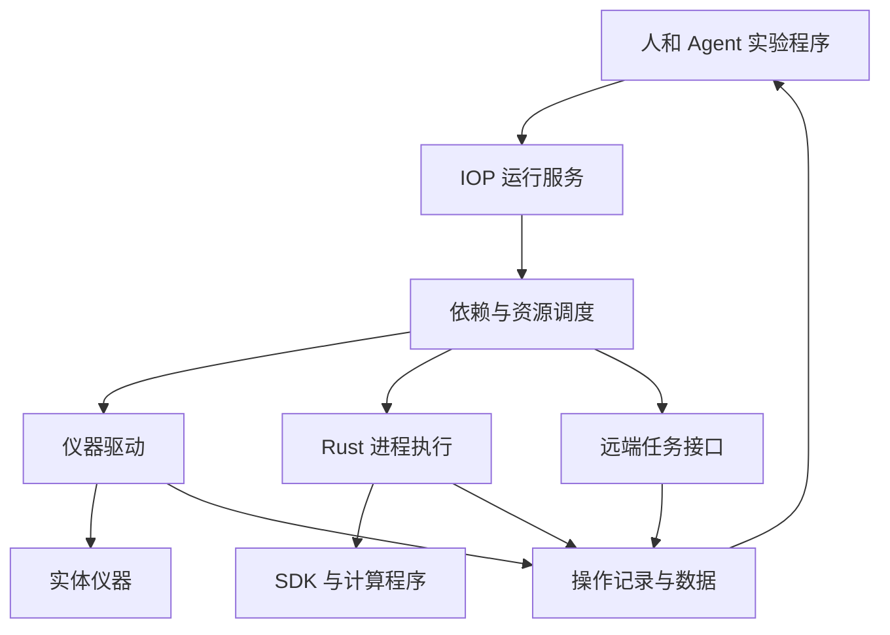

# IOP Runtime 架构

[English](architecture.md) · [安装](README.zh-CN.md) · [实验执行](../../iop/execution.zh-CN.md) · [驱动扩展](../../iop/software.zh-CN.md)

0.8.3 改进[仪器接入](../../iop/instrument-setup.zh-CN.md)、并行调度和实验程序连续调用。[Agent 接入](../../iop/agent-setup.zh-CN.md)复用同一套实验室配置。[软件形态与系统支持](../../iop/product.zh-CN.md)。

IOP Runtime 是运行在实验室计算机上的仪器运行服务。人、Agent 和实验程序使用同一接口，连接实体仪器、计算程序和远端任务服务。一台计算机可管理多个实验平台；平台说明记录设备、物理连接、共享对象与初始化方法。

## 0.8.3 的实现

| 组成 | 职责 | 源码 |
| --- | --- | --- |
| Python 服务 | HTTP、平台配置、依赖与资源调度、驱动适配 | `src/ai4instruments/iop/` |
| Rust 执行组件 | 独立 SDK 会话、普通程序及实验程序的进程树、取消与退出 | `iop/daemon/` |
| TypeScript 客户端 | 提交实验包、调用操作、等待事件、读写结果与文件 | `iop/clients/typescript/` |
| 桌面与网页界面 | 设备登记、平台连接图、实验与结果；桌面启动与浏览器切换 | `desktop.py`、`ui/` |
| SQLite 与文件目录 | 实验状态、操作、事件、配置版本、文件索引与原始输出 | `store.py`、服务数据目录 |

浏览器界面由服务提供静态 HTML 与 JavaScript，不需要单独运行 Node.js。厂商的 C、C++、C#、Java SDK 可使用独立进程接口；普通程序也可直接采用命令行适配器。

## 调度

受理时检查步骤依赖、参数和所需资源，保存实验定义，再返回运行编号。服务建立依赖计数和后继关系；操作完成后只更新其后继。已经就绪的任务在实验之间轮流取得执行机会，无需反复遍历完整依赖图。

资源分配由同一个调度线程决定，驱动通信在工作线程或独立进程中执行。设备默认容量为一；支持并发的驱动声明 `concurrency`。共享对象和计算容量采用同一分配模型：一次取得所需全部数量，执行结束后释放。整个实验的保留份额可供内部操作使用，不重复计算。

`after` 表达时间顺序，`bindings` 表达结果到参数的数据传递。物理接线、共享对象与实验依赖分别描述。严格时序由仪器时钟、控制器和硬件触发执行。

## 程序与驱动

`process` 接口用 JSON 行保持一个 SDK 会话，转发带编号的请求、进度和结果；共用总线或 SDK 的设备可共用进程。`command` 接口运行任意兼容的命令行程序，将输入、输出和进度文件关联到具体操作。实验程序包也由 Rust 组件执行。

Linux 与 macOS 使用进程组，Windows 使用 Job Object 管理后代进程。正常结束、取消、超时以及上层连接关闭都会结束受管程序的后代。直接 Python 驱动保持现有调用接口；需要可以独立终止的厂商 SDK 使用 `process`。

HTTP 任务适配器提交任务、保存任务编号、查询状态，直到远端确认结束。它也可以调用另一台计算机上的 IOP 服务。各服务分别安排本机资源；跨计算机的实验关系由上层实验程序组织。

## 长期执行与数据

实验程序包完成的操作保存到 SQLite，内存仅保留它尚未结束的调用。工作流在结束前保留供后续步骤使用的结果。事件接口支持等待新记录返回；操作历史可按游标分页读取。

SQLite 保存结构化记录，图像、数组和波形保存在文件中。上传与下载按块传输；普通程序的标准输出、标准错误直接写入文件。新版本自动补充文件名索引，保留已有实验记录。

重启后，未开始的实验继续等待；已开始但未完整结束的实验标为中断并保留结果。驱动失联、远端任务状态无法取得等情况会记录未确定的操作及相关资源，待实际状态确认后继续使用。软件进程状态与仪器实际状态分别记录。

## 扩展与维护

新增设备优先增加说明或适配包。运行服务负责公共的执行机制，驱动保留专业操作语义。Python 包通过 `ai4instruments.drivers` 入口发布驱动；其他语言实现独立程序接口。`iop adapters` 显示已安装入口，`iop reconnect` 重建已有驱动连接。

当前 HTTP 服务和工作流调度使用 Python，Rust 负责进程执行。是否继续迁移模块，应由实际通信、记录与调度开销决定。可复现的调度测量位于 `scripts/benchmark_iop.py`，结果见 [运行测量](../../iop/performance/README.md)。
