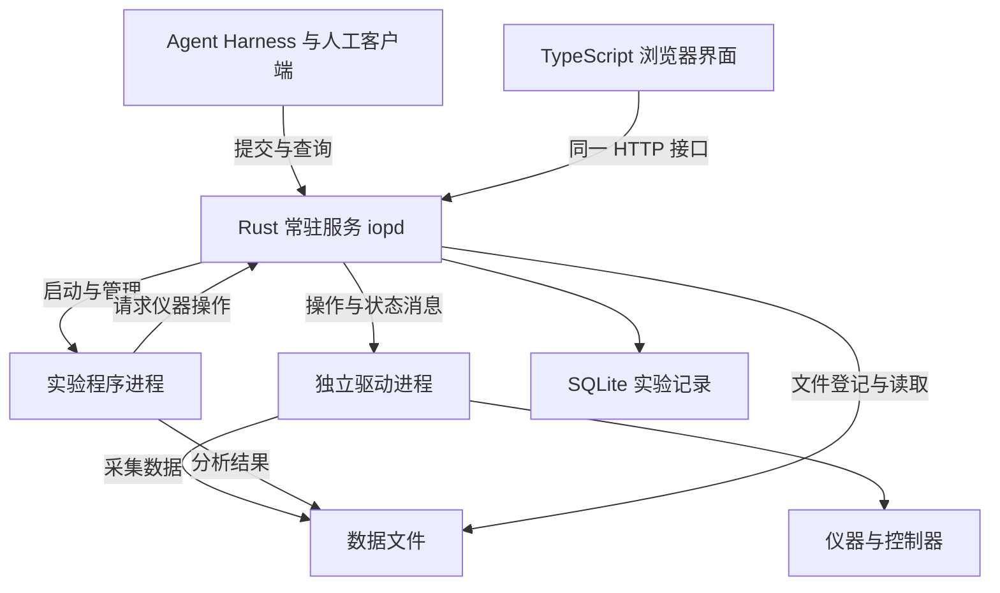

# IOP 常驻服务架构

[English](architecture.md) · [安装与使用](README.zh-CN.md) · [IOP 整体设计](../iop.md) · [现有 HTTP 接口](http-api.md)

**目标：一个实验平台，一个持续运行的仪器服务。** 人与 Agent 提交实验程序，服务管理设备连接、安排操作、保存实验过程。实验可以持续数小时或数天，不依赖提交它的终端、浏览器或 Agent 会话。

采用 **Rust 常驻核心、Python 驱动与实验进程、TypeScript 界面与客户端、SQL 实验记录** 的分工。本文确定目标架构与实现顺序；最初的 **0.3.0 使用 Python 核心与 SQLite**，实现差异见第 8 节。

**0.4.0 实现进展：** 已加入多平台配置与初始化、Rust `iop-execd` 独立驱动进程管理和 TypeScript 客户端。[IOP 工程入口](../../iop/README.zh-CN.md)列明下载与当前能力。HTTP 服务、工作流调度和 SQLite 协调仍在 Python 中；下文的 0.3.0 对照保留为迁移起点。

## 1. 服务在 IOP 中的位置

IOP 包含四部分：**仪器说明、常驻服务、实验程序、实验记录**。这里设计的是常驻服务及其与另外三部分的连接。四种技术承担实现工作，并不构成四类协议。

仪器说明保留原理、物理量、单位、操作方法、参数、完成条件和设备特性。实验程序表达研究方法、条件、循环与分析。服务执行这些操作并保留记录。单台仪器与整个实验平台使用同一套组织方式。

`iopd` 是目标常驻程序的名称。它可以管理多个进程；对实验程序提供一个统一入口。实验程序不直接打开受它管理的仪器连接。已有 EPICS、SiLA 或其他控制系统可以通过适配器接入，设备的实际控制权仍需由接入方式明确。

## 2. 四种技术各自负责什么

| 技术 | 主要职责 | 选择理由与运行方式 |
| --- | --- | --- |
| **Rust** | API、设备登记、任务状态、依赖与资源调度、驱动进程管理、停止与恢复流程 | 长期运行的核心保持较小；类型与所有权机制帮助减少并发和内存错误。用 Tokio 处理异步连接与消息。[1][2] |
| **Python** | 仪器适配、厂商 SDK、实验方法、科学计算与分析 | 保留现有驱动和科研生态。驱动与实验分别在独立进程中运行，依赖不同的 SDK 可以使用不同环境。 |
| **TypeScript** | 浏览器界面、TypeScript 客户端、需要时的 Agent 接入组件 | 客户端与界面共用结构化类型。界面构建为静态文件，由服务提供；常驻核心无需 Node.js 或浏览器。 |
| **SQL / SQLite** | 实验、操作、事件、参数、版本、文件引用的持久保存与查询 | 默认本机数据库，无需另装数据库服务。大体积图像、波形与视频存为文件；SQL 保存其描述和关联。 |

Python 能处理大量等待仪器响应的并发任务。常规 CPython 的 GIL 主要限制 Python 字节码在多个线程上的计算并行；多进程与部分原生计算库有不同的执行方式。可关闭 GIL 的构建已经存在，但厂商扩展是否兼容仍需逐个确认。[3][4]

选择 Rust 核心，是为了集中实现长期运行、明确状态转换和进程管理。Python 驱动进程继续承担适合它的工作。**把同步 SDK 调用包进 Rust 异步函数，并不会让它自动变得可中止。** Tokio 的 `spawn_blocking` 任务开始后也不能靠 `abort` 停止。[5]

这套分工适用于本项目的长期目标，也增加了进程通信、接口版本和安装包维护工作。先保留已有实验接口，再分阶段替换核心；性能收益由同一组工作负载的测量确定。

C、C++、C#、Java SDK 可通过采用其语言的独立适配进程接入。它们是特定设备的可选依赖。SQL 是数据语言；此处默认的数据库实现是 SQLite。

## 3. 串行、并行与设备占用

需要分别处理三种关系：**程序步骤的先后、仪器通信的顺序、物理对象的占用时间**。例如，向恒温台发送设温命令很快，样品达到稳定温度可能需要数分钟。释放通信连接并不等于样品已经可以交给另一项实验。

| 场景 | 调度方式 |
| --- | --- |
| 多个 Agent 同时提交实验 | 独立受理并返回运行编号；按资源与容量安排执行。 |
| 两台互不影响的仪器 | 允许并行，前提是各自的前置步骤已完成。 |
| 同一仪器上的命令与回复 | 默认顺序执行；只有驱动明确支持的独立通道才开放并行。 |
| 多台设备共用串口、控制器或非线程安全 SDK | 用共同资源标识归入同一控制范围，按实际限制排序。 |
| 不同设备作用于同一样品、光路、反应容器或机械区域 | 实验声明共同物理资源，跨相关步骤保留占用。 |
| 高频采样与严格同步 | 服务配置采集与触发；设备时钟、控制器或 FPGA 执行精确时序。 |

目标调度器由一个状态管理任务决定资源归属，耗时的设备通信在独立执行路径上推进。这样多个操作可以同时进行，而设备占用的决定保持一致。

1. 受理请求，保存运行定义与参数，再返回运行编号。重复请求使用同一请求编号读取原结果；同号不同内容返回明确错误。
2. 建立步骤依赖与资源集合。前置步骤完成、资源可用、驱动容量允许时，操作才可执行。
3. 一次取得所需资源；未取得完整集合的操作不持有部分资源。跨步骤占用由实验声明，并在该段实验结束后释放。
4. 对争用同一资源的请求按受理顺序安排；无关资源继续运行。后来的冲突请求不能持续越过已等待的请求。
5. 保存操作开始记录后再发送给驱动；驱动报告实际进展、读数与完成情况。数据库记录与物理动作无法合并为同一个事务，恢复流程必须处理两者之间的中断。
6. 完成条件满足后保存结果，释放相应资源，推进后续步骤。取消与超时分别记录请求、驱动响应及设备当前状态。

最初采用保守的独占资源。需要提高利用率时，再依据设备说明细分独立通道、共享读取或有限容量；只读命令也可能占用通信连接。跨步骤占用所需的资源应预先声明，避免两个实验各持有一部分后再互相等待。

服务的请求队列、驱动队列和数据缓冲都有容量上限。队列满时明确报告稍后重试；状态查询和停止请求保留处理能力。并发上限由设备能力、总线、CPU、内存和存储速度共同决定。自适应调节先调整软件任务数量，不改变仪器的物理限制和采样要求。

### 一个完整的实验例子

材料表征实验 A 使用恒温台、源表、相机和样品 A。它先保留这些设备及样品，再并行进行升温、源表配置与相机配置；确认温度稳定且两台仪器准备完成后，由硬件触发进行采集。计算进程处理采集文件，把拟合结果与原始数据关联保存。

此时，使用独立天平与样品 B 的实验 B 可以继续。另一项需要同一恒温台的实验 C 等待 A 释放设备。如果相机和天平共用某个只能顺序访问的通信设备，两项实验还需共享该通信资源。

并发来自依赖与资源关系。增加线程数量不能缩短升温时间，也不能让同一物理样品同时处于两个互斥条件。

## 4. 驱动进程与持续执行

按设备、共享总线或 SDK 的实际要求划分驱动进程。一个有多个地址的总线可由同一进程持有，多个互不相关的厂商 SDK 可以分别运行。每个设备连接有一个明确的持有者。

常驻核心通过带编号的消息与驱动通信：加载说明、连接、执行、读取状态、停止、关闭。消息携带操作编号、参数和驱动报告的完成状态。驱动标准输出可以用于结构化通信，程序日志另走独立通道；同机的具体传输在驱动进程实现阶段固定。

实验程序由服务启动或通过客户端连接，所有仪器操作返回到服务调度。CPU 密集分析在计算进程中完成，不占用核心处理请求的线程。厂商 SDK 即使崩溃，也应只终止其所在的进程。

**停止客户端等待、停止软件进程、停止仪器动作是三件事。** 超时后，服务保留已发生的操作与数据；驱动需要报告动作是否停止。进程退出不能证明电机、加热或采集已经停止。设备状态未明确时，相关物理资源保持不可分配，其他独立设备继续工作。

服务重启时读取未结束记录，先恢复连接并读取设备状态。可以确认的结果补入原操作；无法确认的动作标明结果未确定，等待设备专用恢复步骤或操作者决定。请求去重能避免重复受理，不能单独保证物理动作恰好执行一次。

## 5. 数据与实验记录

每次实验保留实验程序与说明版本、参数、设备配置、操作顺序、状态变化、原始读数、分析结果和文件引用。采集时间同时注明来自设备还是计算机，必要时保留时钟同步信息。

SQLite 适合作为本机默认存储。WAL 支持读写并行，但同一时刻仍只有一个写入者；数据库放在服务计算机的本地磁盘。[6] 核心通过专用存储任务提交短事务，避免数据库等待阻塞调度。只在运行定义等关键记录已经提交后，向调用者确认受理。

图像、波形和视频走独立的数据传输与文件写入路径。采集进程写入分块文件，服务登记已经完成的块、数据格式和所关联的操作。界面预览可以降采样；原始采集是否允许丢帧必须由实验要求明确，不能静默丢弃。保存速度不足时，根据设备能力降低可配置速率、暂停或结束采集，并记录实际缺失。

需要跨计算机集中检索时，增加汇总服务或 PostgreSQL 存储实现。多个常驻服务不直接共享一个网络盘上的 SQLite 文件，也不通过共享数据库同时控制同一仪器。

## 6. 面向 Agent Harness 的接入

稳定、与语言无关的机器接口是主要入口。Python 与 TypeScript SDK、命令行、网页及 MCP 适配器都使用它。MCP 提供发现和调用方式；实验状态、资源调度和文件仍由 IOP 服务管理。

| 接口内容 | Agent 能直接获得的内容 |
| --- | --- |
| 仪器说明 | 操作、参数结构、单位、适用条件、完成含义与原理资料。 |
| 提交与去重 | 运行编号、受理状态、请求编号与已使用的定义版本。 |
| 进展与结果 | 操作状态、结构化错误、实际读数、结果与文件位置。 |
| 持续连接 | 带位置编号的事件流；断线后从上次位置继续获取。 |
| 停止与继续 | 停止请求是否生效、设备实际状态、哪些步骤允许继续。 |

Harness 启动时优先连接已有服务；没有服务时可以引导安装或启动。多个 Harness 共用同一实验平台的服务。关闭其中一个 Harness 不关闭服务，也不自动取消已经受理的实验。模型服务与网络会话可以更换，本地仪器连接和记录保持独立。

HTTP JSON 延续现有 `/v1` 接口；Python 与未来 TypeScript 客户端共用版本化的消息定义。现有事件轮询可继续使用，后续增加可续接的事件推送。新接口先定义操作状态、单位、错误与兼容规则，再生成客户端类型；更换核心语言不要求重写实验方法。

## 7. 安装与跨系统运行

目标交付是按操作系统与 CPU 架构构建的安装包：包含 `iopd`、静态界面、必要配置与所选驱动运行环境。用户运行核心不需要安装 Rust 编译器或 Node.js。Python 驱动使用随包提供或独立管理的 Python 环境。

| 目标系统 | 服务集成与设备接入 |
| --- | --- |
| Windows | 原生服务；加载适用于当前系统与 CPU 架构的设备 SDK。 |
| Linux | systemd 系统服务或用户服务；按安装方式配置设备访问。 |
| macOS | 按使用方式提供 LaunchDaemon 或 LaunchAgent；适配对应架构的 SDK。 |
| WSL | 运行 Linux 版本；使用已提供给 WSL 的设备，Windows 专用 SDK 由 Windows 端服务承接。 |

跨系统覆盖分开公布：**核心程序能否运行、设备能否被发现、驱动能否连接、具体操作是否得到验证**。发现 USB、串口或网络地址后，还需要匹配仪器说明与可用驱动，才能成为可操作设备。厂商只提供 Windows SDK 的设备，不会因核心换成 Rust 自动获得 macOS 驱动。

先完成单台计算机的完整执行路径。需要多机平台时，增加远端驱动进程的连接与失联处理，并为每台仪器维持唯一的控制来源；跨平台实验协调作为后续能力单独实现。

## 8. 当前实现与建设顺序

| 部分 | 0.3.0 当前实现 | 目标变化 |
| --- | --- | --- |
| 常驻核心 | Python 调度线程、设备线程池、每请求线程的 HTTP 服务 | Rust 异步 API、独立状态管理、有限容量队列。 |
| 驱动 | 在服务进程内调用 Python 驱动 | 独立驱动进程，明确设备连接与进程的归属。 |
| 实验程序 | 已支持独立进程、依赖步骤、跨步骤资源占用 | 延续程序包与资源语义，补充进程恢复与容量管理。 |
| 数据 | SQLite、事件、结果和文件 | 独立存储任务、大数据流、分块文件与完整版本关联。 |
| 客户端 | Python、HTTP、CLI、HTML/CSS/JavaScript 界面 | 增加 TypeScript SDK、静态构建界面、事件推送与可选 MCP 接入。 |
| 中断 | 已开始的实验标为中断，保留记录 | 依据设备读回处理未结束操作，再决定后续执行。 |
| 安装 | 需要 Python；提供安装脚本与登录自启动 | 分系统安装包、托管驱动环境与原生服务管理。 |

现有实现位于 [`src/ai4instruments/iop`](../../src/ai4instruments/iop)，行为说明见[使用文档](README.zh-CN.md)。0.4.0 已加入上述原生驱动组件与 TypeScript 客户端；完整 Rust 调度核心和容量测量结果仍待后续实现。

按下列顺序推进，每一步形成可以运行和比较的结果：

| 顺序 | 交付内容 | 完成时应能看到的行为 |
| --- | --- | --- |
| 1 | 消息与状态定义、Python 驱动进程接口 | 现有 SCPI、Modbus、HTTP 与模拟驱动可独立运行；一个驱动退出后，无关实验继续。 |
| 2 | Rust 核心接替 API、调度与记录协调 | 现有 Python 客户端和实验包继续使用；同设备冲突有序执行，不同设备并行；同一设备只由一个核心管理。 |
| 3 | 容量、停止、重启与大数据处理 | 队列满有明确响应；停止和设备完成状态对应；重启不重复下发结果不明的物理动作。 |
| 4 | TypeScript 客户端、界面及 Harness 接入 | 多个客户端看到同一运行；关闭任一客户端后实验继续；重新连接可以取得后续事件。 |
| 5 | 系统安装包、硬件适配与性能报告 | 公布系统/CPU/驱动组合、实际仪器结果和容量测量；完成安装、升级、卸载与记录保留。 |

性能报告分别测量请求受理时间、调度等待、仪器操作时间、数据吞吐、内存与长时间运行情况。先使用可控的模拟延迟和通信端点，再在真实仪器上测量；软件吞吐与物理实验速度分开报告。Rust 的语言机制有助于减少特定错误，实验正确性仍需用调度行为、设备响应与结果验证。

新实现沿用仓库组织：可复用代码放 `src/`，接口定义与架构放 `docs/runtime/`，实验程序放 `examples/iop/`，行为验证放 `tests/runtime/`。Rust 核心与 TypeScript 包在开始实现时建立各自工程，并与现有 Python 包并存至替换完成。

## 技术依据

以下为技术机制的原始文档；进程划分、调度规则和迁移顺序是本项目的设计选择。

1. [Rust：并发与所有权](https://doc.rust-lang.org/book/ch16-00-concurrency.html)
2. [Tokio：异步运行](https://tokio.rs/tokio/tutorial)；[消息与有限容量通道](https://tokio.rs/tokio/tutorial/channels)
3. [Python：线程与 GIL](https://docs.python.org/3/library/threading.html)
4. [Python：自由线程构建与扩展兼容](https://docs.python.org/3/howto/free-threading-python.html)
5. [Tokio：阻塞任务的停止行为](https://docs.rs/tokio/latest/tokio/task/fn.spawn_blocking.html)
6. [SQLite：WAL 的并发与存储要求](https://sqlite.org/wal.html)
