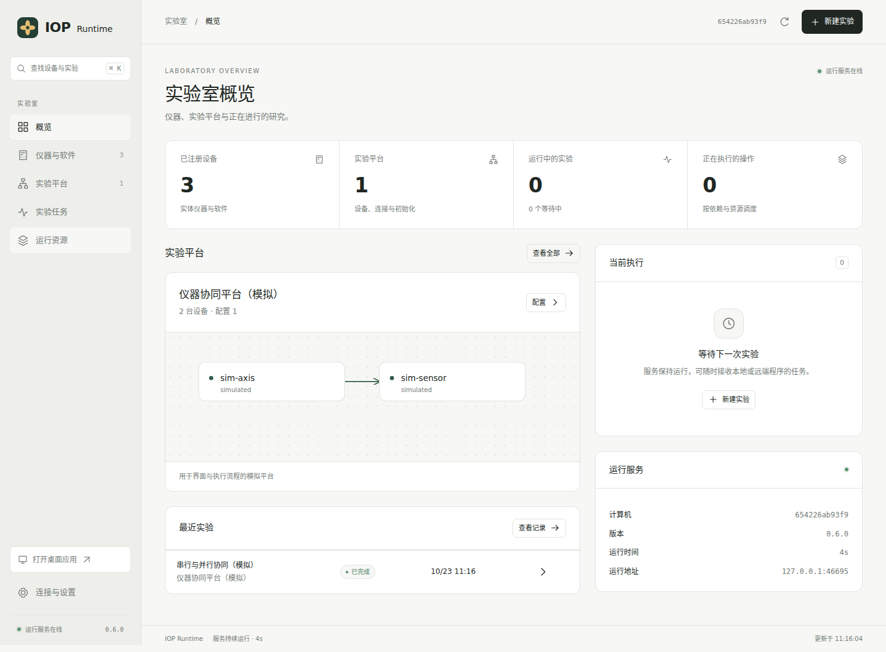

# IOP Runtime

[中文](README.zh-CN.md) · [Download](https://github.com/Cherish0925/AI4Instruments/releases/tag/iop-v0.7.0) · [Desktop & browser](interface.md) · [Installation](../docs/runtime/README.md) · [Platform configuration](platforms.md) · [Agent integration](agent-setup.md)

0.7.0 adds MCP integration, a shared laboratory context, configuration schemas and device recovery. Agents reuse saved instrument and platform descriptions. [Application interfaces, system support and responsibilities](product.md).

**One persistent service for people and agents to use experimental platforms.** It connects physical instruments, computational programs and remote task services, maintains platform descriptions, schedules serial and parallel experiments, and preserves operations and data. Accepted experiments continue after the submitting terminal, browser or agent session closes.

IOP names the Instrument Operation Protocol; IOP Runtime implements its execution functions. [Experiment execution](execution.md) covers dependencies, data flow and resources. [Software and driver extensions](software.md) explains how tools connect.

One computer can serve several experimental platforms. Each platform describes its devices, physical connections, shared resources and initialization procedures. Platforms may reference the same instrument; one service coordinates its use across them.

## Start

Download and extract the matching IOP 0.7.0 archive. For a native desktop window, run `install-desktop.ps1` on Windows or `sh install-desktop.sh` on macOS / Linux, then open **IOP Runtime** from the application menu. Use `install.ps1` / `install.sh` for browser or server use. Python 3.10+ is required; archives include the Rust executor and installers download the required dependencies.

| Archive | Runtime environment |
| --- | --- |
| Linux x86_64 / arm64 | Ubuntu 22.04 or compatible, glibc 2.35+ |
| Windows x86_64 / arm64 | Matching 64-bit Windows |
| macOS arm64 | Apple Silicon, macOS 14+ |
| macOS x86_64 | Intel, macOS 15+ |
| Other OS / CPU combinations | [Install from source](../docs/runtime/README.md) and build the Rust component for that system. |

WSL uses Linux packages and devices exposed to WSL. Windows-specific SDKs can remain with a Windows service.

```sh
iop init
iop start
iop open
```

Desktop and browser share the same interface. Use `iop desktop` for a native window or `iop open` for a browser; both connect to or start the local service. Experiments continue when a window closes.



The screenshot shows a simulated platform with operations, results and connections supplied by the running service.

## Configure the platform, then run experiments

| Stage | Work |
| --- | --- |
| Discover | Inventory visible USB, serial, VISA and registered network connections; match configured drivers. |
| Configure | A person or agent uses actual wiring and instrument documentation to define membership, ports, shared physical objects and initialization. |
| Initialize | Execute declared steps and retain their results. Saving a description does not operate instruments. |
| Experiment | Local or remote programs submit operations or packages, expressing dependencies and resource requirements. |
| Preserve | Link each run to its platform revision, parameters, operations, readings, analysis and files. |

Physical topology and experimental timing are separate. A trigger cable alone does not establish synchronized acquisition: the program must configure and prepare the devices before triggering. Software orders operations; device clocks and hardware triggers provide precise timing.

## Implemented in 0.7.0

| Component | Implementation |
| --- | --- |
| Persistent service | Python HTTP API, scheduler, experiment processes and CLI. |
| Native executor | Rust `iop-execd` owns SDK, command and experiment process trees, progress, cancellation and exit. |
| Scheduling | Ready dependencies, rotation between experiments, result bindings, device concurrency and counted resources. |
| Drivers | SCPI TCP / serial / VISA, Modbus TCP / RTU, synchronous/asynchronous HTTP, executable programs, Python packages and SDK workers. |
| Clients | Python, TypeScript, HTTP, CLI, native desktop and browser interface. |
| Records | SQLite, configuration history, events, packages, output files and raw-data relationships. |

C, C++, C#, Java and other adapters use the same [independent driver interface](drivers.md) or command interface. Their runtime environments are needed only by the relevant programs. In the [current architecture](../docs/runtime/architecture.md), Python handles HTTP and workflow scheduling; Rust handles process execution.

## Project entry points

| Component | Location |
| --- | --- |
| Desktop, browser and interface development | [Guide](interface.md), [interface/](interface/) |
| Platform descriptions | [Configuration guide](platforms.md), [JSON Schema](schema/platform.schema.json) |
| Dependencies, resources and result bindings | [Execution](execution.md), [Workflow schema](schema/workflow.schema.json) |
| Software, remote services and driver packages | [Extensions](software.md) |
| Native driver supervision | [daemon/](daemon/) |
| Python service, clients and drivers | [src/ai4instruments/iop](../src/ai4instruments/iop/) |
| TypeScript client | [clients/typescript](clients/typescript/) |
| Platform and executable-driver examples | [examples/](examples/) |
| Experiment packages | [examples/iop/](../examples/iop/) |
| HTTP interface | [API](../docs/runtime/http-api.md) |

Discovery, driver connection and operation support are documented separately. An attached instrument needs a usable driver and description before its operations can be invoked. Instrument-model coverage and actual hardware results grow with laboratory use.
