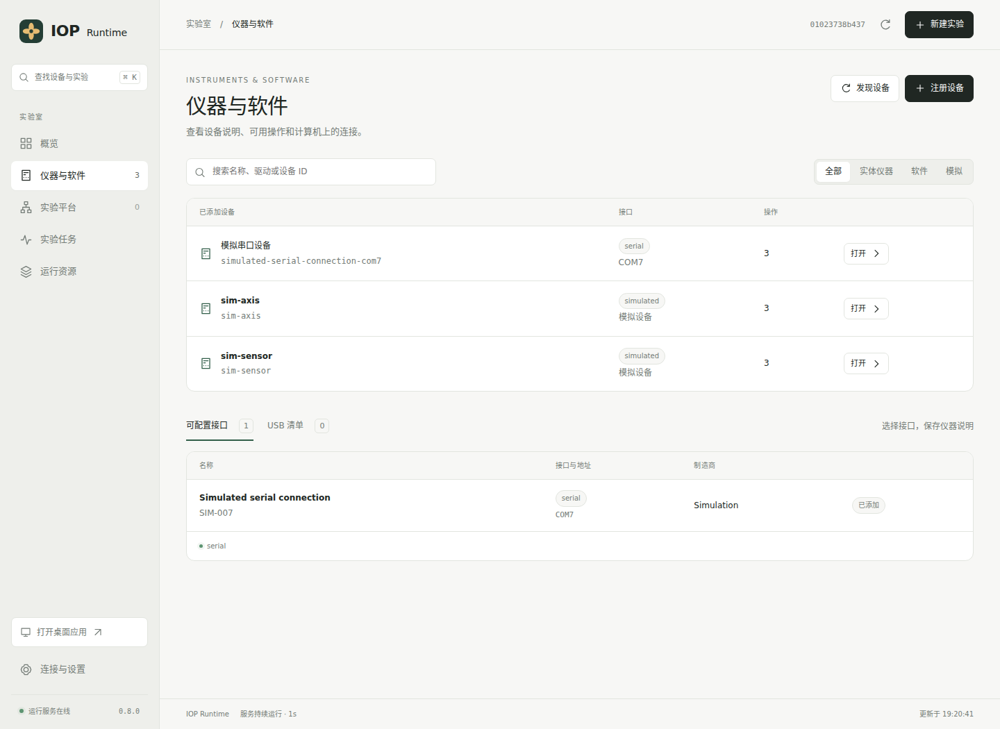

# IOP Runtime · 仪器运行服务

[**软件总览 · HTML**](overview.html?raw=1) — 0.8.3 的软件结构、实验流程、物理与数字操作、Agent 集成和下载入口。单文件，下载后可离线打开。

[English](README.md) · [下载软件](https://github.com/Cherish0925/AI4Instruments/releases/tag/iop-v0.8.3) · [桌面与网页](interface.zh-CN.md) · [安装与使用](../docs/runtime/README.zh-CN.md) · [平台配置](platforms.zh-CN.md) · [Agent 接入](agent-setup.zh-CN.md)

0.8.3 改进共享总线，支持独立安装的型号说明包。[仪器支持包与接入](instrument-packages.zh-CN.md) · [持续实验](continuity.zh-CN.md)。

**让人和 Agent 通过同一个常驻服务使用实验平台。** 服务运行在实验室计算机上，连接实体仪器、计算程序和远端任务服务，执行实验程序，安排串行与并行，保存操作过程和数据。终端、浏览器或 Agent 会话关闭后，已经受理的实验继续运行。

IOP 是仪器操作协议；IOP Runtime 是实现其运行功能的软件。[实验执行](execution.zh-CN.md)说明依赖、数据传递、资源与持续运行；[软件与驱动扩展](software.zh-CN.md)说明如何接入不同工具。

一台计算机可以连接多个实验平台。每个平台有自己的设备、物理连接、共享资源和初始化方法；同一台仪器可以被多个平台引用，由计算机上的同一个服务统一安排使用。

## 开始使用

下载适合系统的 IOP 0.8.3 软件包并解压。桌面使用运行 `install-desktop.ps1`（Windows）或 `sh install-desktop.sh`（macOS / Linux）；安装后从系统应用菜单打开 **IOP Runtime**。只需要浏览器或服务器运行时，使用 `install.ps1` / `install.sh`。发行包内置 Python、Rust 执行程序及 Runtime／Agent 依赖，核心可离线安装；桌面脚本另行下载图形依赖。

| 下载包 | 运行环境 |
| --- | --- |
| Linux x86_64 / arm64 | 服务：glibc 2.35+；ARM64 桌面：glibc 2.39+ |
| Windows x86_64 / arm64 | 对应架构的 64 位 Windows |
| macOS arm64 | Apple Silicon，macOS 14+ |
| macOS x86_64 | Intel，macOS 15+ |
| 其他 CPU / 系统组合 | 使用[源码安装](../docs/runtime/README.zh-CN.md)，按当地系统编译 Rust 组件 |

WSL 使用 Linux 包及已经提供给 WSL 的设备；Windows 专用 SDK 可以由 Windows 端服务承接。

```sh
iop init
iop start
iop open
```

桌面窗口与浏览器使用同一套界面，可以随时切换。`iop desktop` 打开桌面，`iop open` 打开浏览器；两者都会连接或启动本机服务。关闭窗口后，服务继续执行实验。



[仪器接入](instrument-setup.zh-CN.md) · [程序调用与调度测量](performance/README.md)

图中为模拟平台；操作、实验结果和连接图均由运行中的服务提供。

## 配置一次，持续做实验

| 阶段 | 具体工作 |
| --- | --- |
| 发现设备 | 读取计算机可见的 USB、串口、VISA 与已登记网络设备信息，匹配已配置的驱动。 |
| 建立平台 | 人或 Agent 结合实际接线和仪器说明，配置设备归属、端口连接、共享对象、初始化方法。 |
| 执行初始化 | 服务执行明确的初始化步骤，保留每步结果。配置保存本身不触发设备动作。 |
| 开展实验 | 本地或远端程序通过服务提交操作与实验包，按本次实验的依赖与资源要求执行。 |
| 保留结果 | 保存平台配置版本、实验参数、操作、读数、分析结果与文件。 |

物理连接和实验时序分别表达。接了一根触发线，不代表任意一次实验都可以同步采集；实验还需执行设备配置、准备与触发步骤。软件安排执行顺序，设备时钟与硬件触发执行精确时序。

## 现有实现

| 组成 | 0.8.3 中的实现 |
| --- | --- |
| 常驻服务 | Python HTTP API、调度、实验进程与命令行。 |
| 原生执行组件 | Rust `iop-execd` 管理 SDK、命令程序和实验程序的进程树、进度、取消与退出。 |
| 调度与资源 | 依赖就绪队列、跨实验轮流安排、结果到参数的传递、设备并发数与可计数资源。 |
| 驱动 | SCPI TCP / 串口 / VISA、Modbus TCP / RTU、同步与异步 HTTP、命令程序、Python 包与独立 SDK 进程。 |
| 客户端 | Python、TypeScript、HTTP、MCP、命令行、桌面窗口与浏览器界面。 |
| 实验记录 | SQLite、配置版本、事件、实验包、输出文件与原始数据关联。 |

C、C++、C#、Java 或其他语言编写的厂商适配程序，可以使用同一套[独立驱动接口](drivers.md)或命令程序接口。这些语言的运行环境按具体程序安装。[当前架构](../docs/runtime/architecture.zh-CN.md)中，Python 负责 HTTP 与工作流调度，Rust 负责进程执行。

## 工程入口

| 内容 | 位置 |
| --- | --- |
| 桌面、浏览器与界面开发 | [使用说明](interface.zh-CN.md)、[界面工程](interface/) |
| 平台说明与机器可读结构 | [配置说明](platforms.zh-CN.md)、[JSON Schema](schema/platform.schema.json) |
| 实验依赖、资源和数据传递 | [执行说明](execution.zh-CN.md)、[工作流结构](schema/workflow.schema.json) |
| 软件、远端服务与驱动包 | [扩展说明](software.zh-CN.md) |
| Rust 驱动进程管理 | [daemon/](daemon/) |
| Python 服务、客户端与驱动 | [src/ai4instruments/iop](../src/ai4instruments/iop/) |
| TypeScript 客户端 | [clients/typescript](clients/typescript/) |
| 多平台与独立驱动例子 | [examples/](examples/) |
| 实验程序包 | [examples/iop/](../examples/iop/) |
| HTTP 接口 | [API](../docs/runtime/http-api.md) |

设备发现、驱动连接和具体操作支持分别列明。已连接的设备需要有可用驱动与仪器说明，才能成为可操作的设备。实际仪器型号与操作结果随实验室使用逐项补充。
