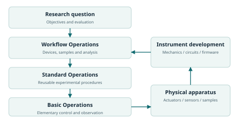

# From Instruments4AI to AI4Instruments

**Shuxing Yang**

## Abstract

The experimental reach of an intelligent system depends on the instruments through which it can act and observe. Much of the work required to bring AI into a laboratory begins with equipment whose physical design, software interfaces and operating procedures were established for other users and purposes. Making that equipment accessible is essential, but it leaves a deeper question: how should instruments be conceived, built and developed when AI is an intended user and an active contributor to their creation? This perspective proposes a transition from Instruments4AI, adapting available apparatus for AI use, to AI4Instruments, integrating AI design and implementation with AI development and use throughout the instrument lifecycle. Its scope is any scientific or engineering setting in which a computational system can intervene in a physical process, control how it is observed, or combine the two. A complete set of Basic Operations exposes the controllable and observable capabilities of an instrument; Standard Operations organise reusable procedures; Workflow Operations compose them across physical entities, devices, places and times. These layers remain open to inspection and revision, including changes to circuits, controllers, firmware and mechanical design. Experimental objectives remain separate from capability descriptions so that established procedures support new inquiry without prescribing its direction. The resulting programme connects three forms of progress: scientific discovery, the development of instruments, and learning from real experimental experience. Its purpose is to expand the space of experiments that intelligence can perform.

## 1. A change in what we ask of instruments

An instrument gives a scientific question a physical form. It establishes a way to intervene, a way to observe, and a relationship between the two. The questions a researcher can investigate therefore depend not only on knowledge and reasoning, but also on the degrees of freedom, sensitivity, timing, geometry and accessibility of the apparatus. Changing an instrument can change which hypotheses are distinguishable and which phenomena can be studied at all.

AI brings this relationship into sharper focus. A computational researcher can potentially sustain attention across many measurements, search a large space of experimental programmes, connect information from different disciplines, and develop software while an investigation is under way. These abilities become scientifically useful only when they can reach the physical system. An inaccessible control, an unobserved state or an inflexible sequence can limit the investigation regardless of how capable the reasoning system becomes.

This limitation is familiar to human researchers. Equipment from different manufacturers and laboratories embodies different assumptions about the operator, the application and the surrounding infrastructure. Interfaces may expose only familiar modes. Software may conceal timing or data transformations. Mechanical arrangements may require manual transfers. Circuit and firmware documentation may be separated from the experimental interface. Integration work then absorbs effort that could have been spent on a scientific question.

Instruments4AI describes the practical response: make available instruments usable by AI. Establish electrical or otherwise programmable control paths; assemble manuals, software development kits and examples; expose operations through libraries, tools and knowledge resources; connect devices in serial and parallel experiments; and develop programmes for particular tasks. This approach has made real autonomous experimentation possible, including work in optical science and chemistry [1, 2].

AI4Instruments asks a question further upstream: **what should an instrument become when AI can participate in its design, implementation, development and use?** An existing device is then both a research tool and an object of research. A limitation encountered during an experiment can motivate a different controller programme, a new observation channel, a revised circuit or a different physical structure. The scientific programme can develop its own means of experimentation.

The transition concerns the starting point and ambition of design. Existing automation, programmable hardware and instrument standards provide important foundations. AI4Instruments brings them into a continuing relationship between intelligence and apparatus, with the aim of enabling richer experiments, sustained autonomous investigation and scientific work beyond the coordination or attention available through manual operation.

## 2. Generality begins with physical relationships

The scope of AI4Instruments is determined by a relationship: a computational system can act on a physical system or control how it is observed, obtain measurements and use the result to decide what to do next. This relationship occurs in individual instruments, integrated laboratories, engineering test environments, manufacturing systems and distributed research facilities. For observational research, the controllable variables can include pointing, timing, sensitivity and acquisition strategy. A list of disciplines can illustrate the scope, but cannot define its boundary.

Likewise, AI does not denote one model family. A language-model agent, a learned controller, a perception model, a Bayesian optimiser, a reinforcement-learning policy or a combination of these can participate at different levels. One system may formulate a question, another may estimate a physical state, and a local controller may execute a precisely timed sequence. The instrument interface should expose useful meaning to all of them without requiring one conversational format or one reasoning architecture.

A general description starts with the entities involved: the apparatus, the object or process being studied, and the environment. It then describes the interventions available, the quantities that can be observed, and the relationships that affect their interpretation. These include physical state, spatial reference, time, material identity, coupling between components, and the history of previous actions. This structure applies whether the observation is an image, a spectrum, a force, a waveform, a composition estimate or a changing population.

Generality requires preserving these distinctions. A common interface that treats every sensor output as an unqualified number discards the information needed to compare experiments. A common command that hides every device behind a fixed procedure discards the freedom needed to devise new ones. The useful common structure is a way to describe capabilities and their physical meaning, with extensions for the details of each apparatus.

The same structure can apply at several scales. A detector contains a sensor, electronics and an acquisition controller. A measurement station combines that detector with sources, positioning and environmental control. A facility combines stations with sample transport and shared infrastructure. At each scale, a subsystem exposes controls and observations while retaining links to its internal implementation. A laboratory can thus participate in a larger experiment without losing the detail needed to understand its measurements.

Three distinctions organise the design problem. A capability may already exist in the hardware but be hidden by the interface. A desired capability may require changing the hardware. Or the apparatus may possess a capability whose behaviour has not yet been characterised well enough to use. These situations call for interface development, instrument redesign and experimental characterisation, respectively. Recognising which situation applies is itself an important part of intelligent research.

The ambition is therefore broader than making a universal driver. It is to make experimental possibilities discoverable, usable, composable and developable. The apparatus may remain physically specialised while the method of describing, investigating and extending it is widely applicable.

## 3. Programming as a route into the physical world

At the interaction boundary, an experiment can be expressed as tool use followed by a tool result: request an action, receive an observation, and continue. This is a powerful simplification because it lets the same programming ability that operates in digital environments reach experimental apparatus. A programme can coordinate devices, analyse signals, construct a new procedure and choose the next intervention.

The electrical path gives this abstraction a physical implementation. Controllers translate instructions into signals; circuits transmit, switch, regulate and drive; actuators change physical conditions; sensors convert responses into signals that can be recorded and processed. In this sense, circuits provide a physical representation of control and sensing, while programming provides an executable representation of how those capabilities are used.

This connection makes circuit understanding and coding central to AI4Instruments. A system that can read a schematic, understand a controller and develop its software has a route to capabilities that an application-level interface may never have exposed. It can change a sampling schedule, construct a waveform, coordinate channels, modify signal processing or develop a new feedback procedure. The relevant physical meaning comes from how the electronics interact with mechanics, materials, fields, transport and the object being measured.

An instrument should therefore offer access at more than one depth. A researcher may begin with a convenient procedure, inspect the Basic Operations beneath it, and descend into controller code, firmware or circuit design when the problem requires it. The relationship between these levels should be documented: which physical quantity a signal influences, how a numerical value is scaled, how an event is timed, and how a result is observed.

The analogy with GPU kernel development is instructive. A high-level interface makes common work convenient; knowledge of the execution architecture permits different algorithms and more effective use of hardware. For an instrument, the architecture includes converters, buffers, clocks, triggers, transducers and physical dynamics. Deep access can create new operating modes as well as improve the speed or efficiency of existing ones. GenICam's machine-readable feature and register descriptions and ARTIQ's timestamped hardware execution illustrate established foundations for this depth [8, 9].

The important timescales should shape where code runs. A planning system can reason over a long investigation while a controller executes rapid sequences locally. A learned state estimator can process a data stream while another process compares experimental designs. Programmes need to express the relationships between these activities, including which event a timestamp denotes and how different clocks relate. This allows AI to develop time-critical experiments without requiring every physical action to wait for online model inference.

Software access and physical observability should be developed together. A requested position, voltage or temperature tells us what a controller was asked to produce. A measurement tells us something about the resulting condition. When a decisive variable remains unobserved, the design question becomes which additional sensor, reference measurement or characterisation would make the experiment informative. The feedback interface improves as the instrument becomes easier to understand.

## 4. An operation system that can grow

Basic Operations, Standard Operations and Workflow Operations describe three roles in the construction of an experiment. Their purpose is to connect elementary capabilities to reusable experimental knowledge and then to an investigation. They are not a fixed catalogue of tasks or a division of scientific disciplines. Their implementations can evolve as the apparatus and the research questions evolve.

### 4.1 Basic Operations: the accessible capabilities of an instrument

A Basic Operation is an elementary act of control or observation at a specified abstraction level. It may configure an output, select a mode, read a state, acquire a signal, define a timing relation or upload a locally executed programme. What counts as elementary depends on the system being described: a controller interface and a complete measurement station expose different levels of physical organisation.

The foundation should be **a complete set of basic operations**. This begins with the instrument's controllable and observable capabilities, rather than with the commands its existing driver happens to provide. The inventory includes independently adjustable quantities, observations, internal modes, state transitions, timing relationships and relevant combinations of controls. Each capability should have a clear executable expression, directly or through a composition that preserves its behaviour.

A declared inventory makes completeness assessable. It also reveals where the boundary should expand. If a sensor supports a useful mode that its current interface omits, that omission is an interface gap. If a missing observation requires a new circuit or transducer, it becomes a design requirement. Completeness is thus both a property to evaluate for a particular revision and a direction for continued development.

The desired foundation has clear and nonredundant meanings. A researcher should understand how two operations differ, which effects they cause and which observations they return. Elementary operations need not correspond to single processor instructions or instantaneous physical events. Nor do distinct meanings imply independent execution: two operations can share a controller, modify the same state or interact through the specimen. Their relationships must remain explicit so that composition preserves physical meaning.

The ambition is to expose every controllable or observable degree of freedom available at the declared level, including those without an established experimental procedure, with enough context to investigate and employ it. A smaller interface is valuable when it expresses that capability clearly. It is restrictive when it hides meaningful variables merely because an earlier application did not need them.

### 4.2 Standard Operations: reusable experimental knowledge

A Standard Operation expresses a repeatable experimental procedure built from lower-level capabilities. It combines actions and observations into a meaningful result. Its definition includes the parameters, conditions, implementation and evidence that make the result interpretable.

A camera acquisition under specified settings is one example. So are reagent addition, stirring and a heating programme; centrifugation, passaging, inoculation, liquid transfer and gradient dilution; thin-film deposition, an electrochemical sequence and solid-state synthesis or sintering. A mechanical loading cycle, an electrical transfer-characteristic measurement or an acoustic excitation-and-recording procedure has the same compositional role. These are illustrations of how procedures emerge, not a closed vocabulary.

A procedure can be developed by a person, generated in code, learned from experimental experience or revised jointly. Its scientific value resides in what it achieves and how that behaviour is established. A procedure used on one apparatus can serve as a starting point on another when its assumptions, physical conditions and outputs can be related.

Standard Operations should remain inspectable and modifiable. A new question may require a different timing sequence, an additional observation, a change in the material path or a different analysis. The operation library should make these changes easier by preserving knowledge of the working implementation, while allowing the researcher to return to Basic Operations whenever needed.

### 4.3 Workflow Operations: an investigation across systems

A Workflow Operation composes experimental procedures across devices, physical entities, time and place. It can express serial dependencies, concurrent activity, repeated measurements, continuous feedback, branching decisions and transfers between subsystems. Analysis and model updates belong in the same experimental organisation because they determine which intervention follows.

An optical investigation may connect source generation, free-space or guided propagation, an interaction and signal acquisition. A preparation-and-characterisation investigation may connect a proposed composition, material processing, transport and complementary measurements. A study of an evolving system may connect assessment, intervention, environmental maintenance and long-term observation. These patterns recur across scientific and engineering settings and can be combined within one research programme.

Composition concerns physical relationships as well as software dependencies. A sample must reach the relevant location; an output must have the required temporal relation to an acquisition; an observation must be associated with the correct entity and history. Concurrent execution is meaningful when the activities can proceed together without changing the intended experiment. The workflow representation should expose these relationships so that a new arrangement can be reasoned about.

The layers are recursive in use. A workflow developed in one project may later become a reusable procedure in a larger investigation. A subsystem's elementary command may itself be implemented by a controller programme. The organising principle is a traceable relationship between intent, composition and physical behaviour, with access to the level at which a new idea can be implemented.

### 4.4 A common description with room for physical difference

**Table 1. Shared elements of an operation description.**

| Common element | Meaning carried between implementations |
| --- | --- |
| Physical capability | The intervention or observation made possible, including its abstraction level. |
| Quantities and entities | Units, data structure, reference frames and the objects or processes involved. |
| Behaviour | State dependence, effects, readback and the conditions defining completion. |
| Time and coupling | Scheduling, triggers, clocks, shared resources and interactions between operations. |
| Implementation | The composition, controller programme and hardware revision producing the behaviour. |
| Experimental evidence | Characterisation, calibration, uncertainty and observations under stated conditions. |

The shared elements support translation between interfaces while retaining instrument-specific detail. Python APIs, command-line tools, typed services, MCP interfaces and other access methods can expose the same underlying meaning. Human-readable explanations and machine-readable descriptions should be linked so that an operation can be understood, executed and improved through different forms of intelligence.

## 5. Established operations should keep research open

A well-developed library can accelerate research, but it can also make familiar procedures disproportionately easy to choose. If a capability description includes praise, preferred research directions or task-specific rewards, the next investigation may inherit a preference before its question has been considered. AI4Instruments places a clear separation between describing what can be done and deciding what is worth doing.

The operation description states behaviour. The evidence record states what happened under particular conditions. The current objective states the question, desired result and criteria of evaluation. The research process selects or develops an experiment using these sources. Keeping these roles distinct makes it possible to reuse a capability without inheriting an unrelated task's definition of success.

This is a practical requirement for open-ended inquiry. An operation library should not reward a researcher simply for following a previously successful workflow, or make one scientific interpretation part of a device's identity. Calibration, measured performance, uncertainty and earlier failures remain useful evidence. Their relevance is judged in relation to the present question, rather than encoded as a permanent preference for one path.

For each new investigation, the system should be able to inspect existing operations, use suitable ones, alter their parameters and implementations, compose alternatives and create new operations. A previous procedure can be a strong starting point without becoming the boundary of what is thinkable. The same principle applies to the apparatus: a novel experiment may justify a different sensing or actuation mechanism rather than another arrangement of familiar commands.

Research objectives also require a broader view than task completion. More measurements can increase throughput without increasing understanding. A carefully chosen intervention may reveal a coupling that a routine sweep misses. An unexpected result may justify changing the question. The system should be able to evaluate efficiency, evidence quality and prospective scientific value together, while retaining the freedom to pursue a more informative experimental direction.

This separates two kinds of development. One improves the implementation of a known procedure. The other changes the available experimental questions, variables or observations. Both matter, but the second is central to the promise of AI4Instruments: intelligence should be able to develop the means of inquiry as well as operate them efficiently.

## 6. AI design and implementation + AI development and use

The lifecycle view begins before a driver exists. A design brief asks which phenomena should be accessible, what interventions are needed, what must be observed and which combinations should remain possible for future experiments. Existing protocols help identify requirements, while the instrument architecture preserves room for uses that have not yet been conceived.

During physical design, AI can contribute to the selection and arrangement of mechanisms, transducers, materials, circuits and controllers. During implementation, it can develop firmware, control programmes, signal processing, simulation models and host software. During manufacturing and assembly, it can help connect design choices to tolerances, component variation, test procedures and the behaviour of individual units. During use, it can characterise the resulting apparatus, discover couplings and build new operations.

The value of participation lies in the connections between these stages. A timing requirement should influence the clock and controller architecture. A need to distinguish two physical hypotheses should influence what is measured. A recurring alignment difficulty may influence the mechanical design. Variation between manufactured units should appear in characterisation and calibration. The instrument becomes more useful when information can pass through the whole lifecycle.

**Table 2. Instrument development across the lifecycle.**

| Stage | Central question | Information carried forward |
| --- | --- | --- |
| Conception and planning | Which experiments should become possible? | Required interventions, observations, scales and relationships. |
| Physical and electronic design | Which mechanisms can realise those possibilities? | Geometry, materials, circuits, sensing and execution architecture. |
| Implementation and manufacturing | How is the design made into a functioning instrument? | Hardware revisions, firmware, assembly variation and test results. |
| Characterisation and use | What does the actual apparatus do, and what can be learned with it? | Response models, calibration, operations, trajectories and findings. |
| Continued development | Which change would most expand useful experimental capability? | Evidence-backed revisions to software, hardware and procedures. |

Hardware and software should be developed together. Exposing a control with no useful observation may leave the physical effect ambiguous. Adding a sensor without making its data available may leave its value unused. A mechanical change may require a new coordinate model; a firmware change may alter timestamp semantics. Co-development makes these relationships part of the instrument's description.

The process can also reveal opportunities beyond correcting defects. A controller designed for one sequence may support a new combination of channels. Two measurements previously conducted separately may be synchronised to reveal a transient relationship. An apparatus may become useful for a different question after adding one controllable variable. Richer access permits exploration of the possibilities within existing hardware; design participation permits creation of possibilities beyond it.

Continued development should leave a history that later researchers can understand. Instrument revisions, programme versions and characterisation results establish which capabilities were available for a given experiment. A finding can then be related to the apparatus that produced it, and an improvement can be evaluated against the limitation or opportunity that motivated it.

## 7. Persistent physical research and cumulative experience

A sustained investigation is a changing relationship between an apparatus, a physical subject and a research question. Components drift, specimens evolve, resources are consumed, and observations change the researcher's understanding. Long-term autonomy therefore depends on the ability to observe and respond to evolving conditions, carry knowledge forward and maintain the identity of the experiment through change.

The experiment should be resumable from what is known about the physical state. This differs from continuing at a line number in a script. An interrupted procedure may have partly changed a specimen; a controller may have completed an action before communication was lost. The useful continuation depends on subsequent observation and the meaning of the action. Expressing partial progress, completion and current state gives an intelligent system a basis for deciding how research can proceed.

Physical history is often part of the phenomenon. A material's processing history, an object's loading history, an environment's variation or a sample's lineage can explain an observation. A reusable operation should preserve the information needed to relate a result to that history. This principle extends from a single sensor trace to a campaign distributed across instruments and laboratories.

The experimental record should link the question and its alternatives to the programme, apparatus configuration, interventions, raw observations, analysis and decisions. Requested values, reported device state and independently measured quantities should be distinguishable. Derived quantities should retain their relation to the data and transformation that produced them. This makes the trajectory useful beyond the immediate decision of the current system.

Such records have scientific value even when an experiment is inconclusive. An unexpected response can expose an unmodelled coupling. A failed procedure can identify a missing observation. A reproducible discrepancy can motivate instrument development or a new hypothesis. Preserving these relationships allows experience to accumulate rather than disappear when a task ends or a model changes.

## 8. Experiments can develop intelligence and apparatus together

Real experimental experience offers several different kinds of learning. A system can learn how an instrument responds to interventions, how to interpret its observations, how to write an effective control programme, how to choose an informative experiment and how to recognise a limitation of the apparatus. These forms of learning connect physical modelling, perception, programming, planning and engineering design.

Interventions are particularly important. A passive observation records what was seen; an experimental trajectory also records what was changed and under which conditions. Comparing interventions and responses can help distinguish competing accounts of a system. The trajectory must retain enough context to determine whether the apparent effect comes from the intended variable, another coupled variable or a change in the experimental environment.

The same experience can guide different improvements. A sequence of measurements may support a better model of a physical process. A record of repeated discrepancies may support better controller code. An observation that several experiments remain ambiguous may motivate an additional sensor. The value of the trajectory is therefore larger than the final answer to the original task.

Three mutually reinforcing forms of progress follow. Scientific progress produces findings and better explanations. Instrument progress expands the interventions and observations available. Model progress improves interpretation, experimental design and the development of implementations. Their relationship is the broader reason to bring AI into physical research: the system can obtain the experience needed to improve both its understanding and its means of inquiry.

This relationship suggests concrete learning tasks. Predict an apparatus response before performing an intervention. Develop a procedure on one instrument and adapt it to a second. Identify a missing measurement from an ambiguous trajectory. Generate an improved implementation and compare its physical behaviour with the previous one. Design an experiment that separates two hypotheses using the available capabilities. These tasks connect model improvement to experimentally observable performance.

Evaluation should preserve the distinction between remembering an apparatus and acquiring transferable ability. New instruments, changed configurations, unfamiliar samples and different questions provide useful tests. Comparisons should identify which gains came from better models, richer access, additional measurements or changed hardware. A corpus of well-described interventions and outcomes can support this work across model families, including systems whose training and inference methods differ substantially.

## 9. Open capabilities across laboratories

Scientific capabilities are distributed across laboratories, institutions and regions. Each setting contains instruments, methods, tacit knowledge and observations that may be useful elsewhere. Incompatible descriptions and inaccessible implementations make it difficult to connect those resources. AI4Instruments treats openness as a way to make experimental capability understandable and reusable across these boundaries.

Several forms of exchange matter. A laboratory can publish an instrument description, a controller implementation, a reusable procedure, characterisation evidence or an experimental trajectory. Another laboratory can inspect the contribution, identify the capabilities it requires and determine how it relates to local apparatus. Where a procedure transfers, the adaptation and new evidence can become part of the shared knowledge.

Compatibility requires more than matching command names. A nominally identical operation can produce different physical conditions on different equipment. Comparable experiments require relationships between quantities, geometry, timing, calibration and preparation history. A shared description should make those relationships explicit while retaining the differences that matter to the scientific result.

Distributed experimentation also becomes possible. One facility may create a specimen, another may provide a specialised measurement, and another may perform an independent replication. A workflow can connect these contributions through physical identity, requirements, observations and analysis. Local execution remains linked to the detailed knowledge of each apparatus, while the larger investigation can reason about the combined evidence.

This programme can build on existing work. SiLA 2 and OPC UA LADS provide structured descriptions for laboratory devices [3, 4]. EPICS, Bluesky and Ophyd provide established approaches to control, device representation and experimental execution [5-7]. GenICam and ARTIQ address important aspects of hardware description and timing [8, 9]. The Model Hardware Standard research preview addresses AI-facing integration and multi-instrument orchestration [10]. Autonomous chemistry, materials and robotic-laboratory research supplies further experimental precedents [2, 11, 12]. These contributions occupy different parts of the design space and can inform interoperable implementations.

The broader objective is cumulative experimental knowledge: a useful implementation or observation should be able to improve research beyond the place where it originated. Open descriptions and evidence can lower the effort needed to reuse specialised apparatus, compare results and undertake joint investigations. They create opportunities for scientific work that depends on capabilities no single laboratory possesses alone.

## 10. Building the programme

AI4Instruments is intended as a developing methodology and an open body of implementations, experiments and ideas. Its structure should grow through concrete instrument work while remaining general enough to accommodate new mechanisms, model families and research settings. The essential contribution of a device integration is the capability it makes understandable and usable; the essential contribution of a design change is the experimental possibility it creates or improves.

The repository provides a starting framework: operation descriptions, instrument-design guidance, illustrative experimental relationships and a small executable reference. The reference uses a simulated optical system to make control, readback, composition and feedback inspectable. Its place is an implementation example of a broader methodology. Other instruments and research programmes can use different physical models, transports, execution systems and learning methods while preserving the same explicit relationships between capability, behaviour and evidence.

Development should proceed along connected questions. Can a system discover and use an instrument's capabilities without relying on a manually chosen workflow? Can it create a new procedure from elementary operations? Can that procedure be adapted to a different implementation? Can the system sustain an investigation while conditions change? Can it identify when a scientific limitation requires better software, additional measurement or different hardware? Can the resulting experience improve a later model or experiment?

The evaluation should reflect these ambitions. Capability coverage concerns the richness and accessibility of the physical inventory. Composition concerns the range of new experiments that can be expressed. Transfer concerns how physical meaning survives a change of apparatus or setting. Sustained operation concerns useful observations and scientific progress over time. Instrument improvement concerns measured changes in experimental ability. Learning concerns improved performance on new questions and conditions.

**Table 3. Research directions and substantive demonstrations.**

| Direction | A substantive demonstration |
| --- | --- |
| Full capability access | A hardware-grounded inventory with executable controls, observations and characterised relationships. |
| New experimental procedures | A procedure developed from available operations to address a question beyond the supplied examples. |
| Cross-instrument generalisation | A shared scientific task carried across different implementations, with adaptations and physical results explained. |
| Persistent investigation | A long-running study that preserves state, history and useful evidence as conditions evolve. |
| Instrument development | A software or hardware change that enables a previously inaccessible experiment or materially improves its quality. |
| Learning from physical experience | An improvement on unfamiliar tasks or apparatus traceable to the use of experimental trajectories. |
| Collaboration across laboratories | A joint investigation whose contributions can be related, reproduced and assessed across sites. |

The long-term aspiration is for AI to perform research beyond the practical limits of manual experimentation: more sustained, more coordinated, more adaptive and capable of developing new apparatus along the way. The significance lies in the scientific questions that become answerable and in the shared knowledge produced by pursuing them.

The transition from Instruments4AI to AI4Instruments places the instrument within the developing intelligence of the research process. AI can use what has already been built, understand how it works, create new ways of operating it and help build what the next question requires. Real experiments then contribute not only answers, but also better instruments and more capable scientific systems.

## References

[1] Shuxing Yang et al. (2026). [End-to-end autonomous scientific discovery on a real optical platform](https://arxiv.org/abs/2604.27092). arXiv:2604.27092.

[2] Daniil A. Boiko, Robert MacKnight, Ben Kline and Gabe Gomes (2023). [Autonomous chemical research with large language models](https://www.nature.com/articles/s41586-023-06792-0). Nature 624, 570-578.

[3] SiLA Consortium (n.d.). [SiLA 2 Standards](https://sila-standard.com/standards/). Official standards documentation. Accessed 2026-10-15.

[4] OPC Foundation, SPECTARIS and VDMA (n.d.). [OPC UA for Laboratory & Analytical Device Standard (LADS), Part 1: Basics](https://reference.opcfoundation.org/specs/OPC-30500-1/full). OPC 30500-1, version 1.0.0. Accessed 2026-10-15.

[5] EPICS Collaboration (n.d.). [About EPICS](https://epics-controls.org/about-epics/). Official project documentation. Accessed 2026-10-15.

[6] Bluesky Project (n.d.). [Bluesky Data Collection Framework](https://blueskyproject.io/bluesky/v1.13.1/index.html). Version 1.13.1 documentation. Accessed 2026-10-15.

[7] Bluesky Project (n.d.). [Ophyd](https://blueskyproject.io/ophyd/). Official project documentation. Accessed 2026-10-15.

[8] European Machine Vision Association (2016). [GenICam Standard: Generic Interface for Cameras](https://www.emva.org/wp-content/uploads/GenICam_Standard_v2_1_1.pdf). GenApi standard, version 2.1.1.

[9] M-Labs and ARTIQ contributors (n.d.). [ARTIQ Real-Time I/O Concepts](https://m-labs.hk/artiq/manual/rtio.html). Official ARTIQ manual. Accessed 2026-10-15.

[10] Anthropic (2026). [Previewing the Model Hardware Standard](https://www.anthropic.com/news/model-hardware-standard-research-preview). Research preview announcement, 27 August.

[11] Nathan J. Szymanski et al. (2023). [An autonomous laboratory for the accelerated synthesis of inorganic materials](https://www.nature.com/articles/s41586-023-06734-w). Nature 624, 86-91; corrected 2026. [Author correction](https://www.nature.com/articles/s41586-025-09992-y).

[12] Benjamin Burger et al. (2020). [A mobile robotic chemist](https://www.nature.com/articles/s41586-020-2442-2). Nature 583, 237-241.
