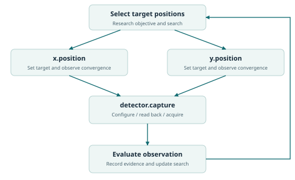

# AI4Instruments

## Instruments as programmable partners in scientific discovery

**Shuxing Yang**

### Abstract

Scientific instruments determine which questions can be tested, how quickly evidence can be obtained, and which observations become available for learning. Their interfaces often expose a smaller space of experiments than their hardware could support. Connecting an AI system to an existing driver therefore addresses only part of the problem. AI4Instruments proposes a broader design programme: AI participates in the conception, implementation, development and use of instruments, while instruments expose their capabilities in a form that supports inspection, composition and revision. The approach connects three levels: Basic Operations describe elementary control and observation at a declared hardware abstraction level; Standard Operations express reusable experimental procedures; Workflow Operations coordinate instruments, samples and analysis across an experiment. Completeness is evaluated against an explicit capability inventory, rather than asserted for all possible physical behaviour. The same architecture connects circuit and controller programming, mechanical design, experimental feedback and cross-laboratory knowledge. This paper develops the underlying methodology, worked examples, an executable simulated reference and a research agenda. Its central proposition is that experimental capability should remain open to development: a scientific system should be able to improve the apparatus and its operations as well as choose the next experiment.

## 1. The instrument is part of the scientific question

A laboratory can possess an excellent detector and still be unable to perform a useful experiment. The required trigger may be inaccessible through its driver. A camera may return images without the exposure state that produced them. A pump may acknowledge a command without measuring the transferred volume. A controller may expose only a few predefined sequences, even though its electronics can generate a much richer family of signals. In each case, a physical capability exists, or could be developed, but the experimental programme cannot reliably reach it.

Such gaps accumulate across instruments. Differences in connectors, communication protocols, coordinate systems, clocks, software versions, sample holders and data formats turn an apparently simple experiment into a substantial integration project. A human operator often compensates using tacit knowledge: listening for a motor, watching a meniscus, recognising a saturated image, or remembering that an instrument needs several seconds to settle. These observations seldom appear in the interface available to a computational researcher. The resulting difficulty is not exclusive to AI; it already consumes human scientific effort.

Autonomous experimentation makes these omissions more visible. A system expected to work over many hours must distinguish a requested change from a completed change, preserve sample identity through a handoff, and understand whether an observation is informative. It must also revise experiments when the original plan encounters something unexpected. A sequence that runs once is evidence of integration. It is not yet evidence of sustained experimental competence.

Recent work demonstrates that AI systems can participate in real experimental research, including chemistry and optical science [1, 2]. These results motivate a further question: what would instruments look like if their designers expected computational researchers to inspect, program, characterise and improve them throughout their working lives? AI4Instruments addresses that question as a joint problem in instrument engineering and scientific method.

The long-term ambition is to make experiments possible that exceed the attention, coordination, search capacity or persistence available to individual human researchers. This includes large experimental campaigns, adaptive measurements, intricate synchronisation and research shared across laboratories. The contribution developed here is a design framework and an initial executable reference for pursuing that ambition.

## 2. From adapting instruments to co-developing them

In this project, **Instruments4AI** names an integration-first approach: start with available equipment and make it usable by an AI system. **AI4Instruments** names a lifecycle approach: involve AI in the design and development of the instrument itself, and carry what is learned during use back into its design. These are complementary perspectives, not a chronological division of all previous and future work. Programmable instrumentation, laboratory automation and hardware description systems already provide substantial foundations.

An integration-first route commonly has five stages. Establish a programmable path to each relevant actuator and sensor, whether through an existing controller or an added mechanism. Gather interfaces, manuals, software development kits and examples. Expose knowledge and operations through software libraries, tools or structured services. Connect devices in representative serial and parallel experiments. Then express new research tasks as new experimental programs.

This route is valuable because it puts existing laboratories to work. Its limitations appear when the interface has already fixed what can be done. A tool wrapper cannot expose a sensor that was never installed. A better prompt cannot eliminate an undocumented controller delay. An additional workflow cannot recover a hardware degree of freedom hidden behind an unavailable firmware interface. These cases require changes to the instrument or to the evidence available about it.

The lifecycle view can be expressed compactly as **AI design and implementation + AI development and use**. During design, a computational researcher helps translate experimental questions into measurable quantities, controllable variables and physical structures. During implementation, it develops electronics, firmware, software and supporting mechanical designs. During use, it characterises performance and creates operations. During redesign, the accumulated evidence identifies which hardware or interface changes would unlock new experiments.

The feedback is bidirectional. Better instruments enable better scientific decisions; better scientific decisions reveal what the next instrument should measure or control. A persistent saturation problem may justify a different detector or optical attenuation path. Repeated uncertainty about transferred liquid may justify additional sensing. A demand for reproducible pulse sequences may justify moving execution from host software into a timing controller. Instrument development becomes a continuing part of research.

Existing projects overlap with important parts of this programme. SiLA 2 and OPC UA LADS organise laboratory capabilities and information [3, 4]. EPICS, Bluesky and Ophyd support distributed control and experimental execution [5-7]. GenICam addresses interoperable camera features [8]. ARTIQ provides a route from programs to precisely timed hardware actions [9]. The Model Hardware Standard research preview explicitly addresses AI-facing device integration and orchestration [10]. AI4Instruments connects these concerns to capability completeness, revisable operation layers and the full instrument lifecycle; useful existing standards should be reused wherever their semantics fit.

## 3. The programmable physical interface

The compact interaction pattern of computational experimentation is action followed by feedback. A program issues a command, the physical system evolves, and observations inform the next decision. For an AI system, this can be exposed as tool use and tool result. The simplicity of that interface is useful, but its scientific meaning depends on what lies beneath it.

An electrical control path often connects software to the physical world. Digital messages configure controllers; converters translate values into voltages or currents; actuators change mechanical, thermal, optical or fluidic conditions; sensors transduce physical quantities into observable signals. Coding is therefore a powerful common route through heterogeneous apparatus. Circuit knowledge adds the ability to reason about how a requested operation is physically realised.

Electronics do not exhaust an instrument's behaviour. Mechanics, transport, material properties, geometry, environmental coupling and sample preparation can determine whether a command has its intended effect. A complete design description must connect these physical elements to their controllable and observable consequences. Where an important variable has no actuator or sensor, software should identify the missing capability and motivate a design change.

Deep access matters because many experimental possibilities sit below the application interface. A controller may support a different acquisition schedule; an FPGA may permit event-triggered processing; a sensor may expose calibration or readout modes absent from the graphical application. The analogy to GPU kernel optimisation is useful: performance depends on understanding the hardware execution model, rather than using only the highest-level library. In instrumentation, that execution model includes physical settling, timing resolution, transfer functions and measurement uncertainty.

Abstraction should preserve this depth. A convenient acquisition function should link to the operations and controller program that implement it. A controller program should identify the firmware and hardware configuration under which it was characterised. A researcher should be able to descend through the stack when a scientific question demands a different implementation, and return to a reusable higher-level operation once that implementation is understood.

Timing introduces a further distinction. Scientific planning may occur over seconds or minutes; a pulse sequence may require deterministic scheduling at a much shorter timescale. The planning system can generate and evaluate a program while a local controller executes its time-critical sequence. Each operation should state whether it is host-scheduled, controller-scheduled or externally triggered. Otherwise, a syntactically valid workflow may encode a physically impossible timing assumption.

## 4. Three levels of experimental operations

The terminology is deliberately short: **Basic Operations**, **Standard Operations** and **Workflow Operations**. These names describe the meaning of an operation, rather than a required transport protocol, model architecture or software package.

### 4.1 Basic Operations

A Basic Operation is an elementary, explicitly specified act of control or observation at a declared instrument abstraction level. Examples include setting an exposure duration, reading a controller status, selecting a trigger source, moving an axis to a target, or acquiring a detector frame. At a lower level, the appropriate operation might configure a register field, upload a waveform or sample an analogue input. The abstraction level must be named; elementary is relative to that level.

The desired interface is **a complete set of basic operations**. Completeness means that every applicable capability in a declared inventory has an executable representation, directly or through a documented composition that preserves its required behaviour. Unexposed capabilities remain explicit gaps in coverage. An inventory should include adjustable quantities, observations, configuration modes, timing relations and relevant state transitions. It should be grounded in the hardware design and measured behaviour, not inferred solely from the commands already present in a driver.

A numerical inventory coverage measure can be useful: implemented and verified inventory items divided by applicable declared inventory items. Its denominator must accompany the number. Covering every entry in a small list says little about the richness of that list, and merely implementing an API says little about its physical correctness. Coverage therefore needs a capability matrix linking each item to its operation, implementation level and verification evidence.

Elementary does not mean a single machine instruction, an indivisible physical event, or a database-style atomic transaction. Moving a stage is a continuous process even if the exposed command is elementary. Likewise, a minimal command count is not the primary goal. Combining many unrelated effects into one command can reduce the API size while making experimental reasoning harder.

The useful criterion is clear, nonredundant semantics. Two differently named operations should not conceal the same behaviour without a reason, and one name should not ambiguously describe several effects. This does not imply that operations cannot conflict during execution. Two valid operations may require the same actuator or alter the same configuration. Those relationships belong in their resource and state descriptions.

### 4.2 Standard Operations

A Standard Operation is a reusable experimental procedure built from Basic Operations and, where appropriate, other reusable procedures. It bundles a scientifically meaningful action with its parameters, completion criteria and observations. The word standard denotes a documented reusable procedure within a declared instrument profile.

A camera acquisition procedure might configure exposure and gain, arrange triggering, acquire frames and return images with the settings and timestamps that produced them. A liquid-transfer procedure might combine aspiration, motion and dispensing with observations of the transfer. A thermal procedure might implement a temperature programme and record its measured trajectory. The common feature is a meaningful experimental result, not a particular number of low-level commands.

A procedure should expose assumptions that affect interpretation. A camera routine may assume a specified illumination condition. A dispensing routine may have been characterised for a particular fluid class. A deposition routine may depend on substrate position and chamber state. These facts help a researcher decide whether a procedure is applicable or should be changed.

Reuse should preserve inspectability. An operation should record its implementation version and the lower-level operations it invokes. When a procedure fails to serve a new experiment, the research system should be able to alter its implementation or construct a different composition. A library of procedures is a source of working knowledge, not a fixed menu of scientific questions.

### 4.3 Workflow Operations

A Workflow Operation coordinates an experimental programme across devices, samples and analysis. It can contain serial dependencies, concurrent branches, synchronisation points, conditional steps and feedback loops. Its output is the linked experimental record needed to answer a question or choose a subsequent experiment.

For example, an optical workflow configures a source, prepares a propagation path, establishes the interaction with a sample, acquires observations and evaluates the result. A materials workflow connects formulation, synthesis, processing and characterisation. A biological workflow connects sample assessment, handling, environmental maintenance and time-resolved observation. The dependency structure must express physical readiness and sample movement as well as software data flow.

An instrument acknowledging a command is not enough to release every downstream action. A heater may have accepted a target while the sample is still warming. A robot may have finished its motion while a specimen is still vibrating. A workflow should specify the observation or completion condition that makes its next step meaningful. Conversely, independent work can proceed concurrently when the physical and resource relationships permit it.

### 4.4 A common operation description

| Element | Question it answers |
| --- | --- |
| Identity and version | Which precise behaviour and implementation are being invoked? |
| Inputs and outputs | What quantities, units, shapes and data types are accepted and returned? |
| State and completion | What changes, what is measured, and when is the operation complete? |
| Timing | Which clock, trigger, duration and scheduling assumptions apply? |
| Resources | Which devices, channels, sample positions or shared mechanisms are involved? |
| Evidence | Under which conditions was the behaviour characterised, and with what uncertainty? |
| Composition | Which lower-level operations implement this behaviour? |

This description can be carried by a Python library, a typed service, a command-line interface or a tool protocol. A common semantic core allows multiple access methods without forcing all instruments into an identical physical model.

## 5. Keep capability separate from preference

Operation libraries can silently narrow a research programme. A mature workflow is easier to retrieve than an unfamiliar one. A highly polished example can become the default answer to questions it was never designed to address. If operation metadata contains task-specific praise or rewards, an agent may inherit an experimental preference before considering the actual scientific objective.

AI4Instruments therefore separates four things: what an instrument can do, what has been observed when it does it, what a particular research task values, and how a candidate experiment is selected. Capability descriptions specify behaviour. Evidence records preserve measured results and conditions. Objectives define the current question and evaluation criteria. A planner or optimisation algorithm chooses among possible experiments using these sources explicitly.

This separation preserves useful knowledge. Calibration, uncertainty, failure observations, resource cost and measured performance are evidence whose relevance depends on the current task and conditions. The practical objective is to prevent hidden task preferences from being embedded in reusable capability definitions, and to make the basis of experimental decisions inspectable.

For a new task, an AI system may reuse a Standard Operation, parameterise it differently, inspect and revise its implementation, or compose Basic Operations into a new procedure. The same freedom applies to Workflow Operations. An established protocol should earn its place through applicability and evidence. An alternative should be judged by the question it can test and the quality of the observations it can produce.

Efficiency and innovation also need explicit interpretation. Maximising successful calls is different from maximising scientific information. A slow measurement may discriminate between hypotheses that many fast measurements cannot distinguish. A useful research system evaluates throughput together with uncertainty, coverage of hypotheses, reproducibility and the value of the question being answered.

## 6. Designing the instrument through its lifecycle

The lifecycle begins with a capability argument. What physical quantities should be controlled? Which should be observed? Which interactions and timescales matter? What evidence would distinguish a successful experiment from an apparent one? These questions lead to the mechanics, transducers, electronics and computational architecture, rather than appearing only after those choices have been fixed.

Design documentation should connect these decisions. A controllable quantity should link to the actuator and circuit that realise it. An observed quantity should link to its sensor, calibration and data path. A timing requirement should link to the relevant clock and execution mechanism. A mechanical interface should identify the coordinate frame, sample geometry and alignment assumptions that software needs to understand.

During implementation, AI can contribute circuit analysis, firmware, controller programs, numerical models, test software and mechanical design proposals. The useful unit of progress is an experimentally characterised capability. A register write that changes an output is an implementation step; a documented relationship between requested and measured output establishes what that step means for an experiment.

Manufacturing introduces variation. Component tolerances, assembly geometry, sensor offsets and replacement parts can change behaviour without changing the operation name. Instrument identity and configuration therefore belong in the experimental record. Calibration characterises a particular apparatus under stated conditions and links its outputs to physical quantities. Recalibration and maintenance update that evidence rather than silently rewriting past results.

Use produces requirements that were difficult to anticipate during initial design. Researchers discover inaccessible timing combinations, insufficient observation, costly sample transfers or operating regimes that need different components. These findings should become structured design issues, supported by trajectories and measurements. The next revision can then be evaluated against the experiment that motivated it.

This approach changes the target of optimisation. The goal is not always maximum speed or the largest number of adjustable parameters. It is the greatest useful experimental capability for the scientific questions at hand, with sufficient observability to establish what happened. Additional degrees of freedom are valuable when they enable interpretable interventions, rather than adding undocumented complexity.

## 7. Worked experimental designs

The following examples show how the operation levels support different sciences. They are design examples; the repository's executable example is the simulated optical system described in Section 8.

### 7.1 Optics: discover the response before choosing the procedure

Consider a source, a controllable optical path, a specimen and a camera. Basic Operations expose source settings, axis positions, detector configuration, triggers and observations. Standard Operations establish a source condition, move and measure a path setting, or acquire an image with its metadata. Workflow Operations connect source generation, propagation through free space, fibre or a photonic device, light-matter interaction and signal analysis.

An unfamiliar alignment problem illustrates why the lower layers matter. A fixed alignment routine may assume that a particular motor moves the image along a particular axis. Instead, the researcher can make small interventions, measure the response and estimate the local relation between control and observation. It can then construct an appropriate alignment procedure or discover that an additional degree of freedom is needed.

The observation must retain more than a scalar score. Images, detector settings, actual positions, timing and relevant reference measurements allow later analysis of saturation, drift and changes in the optical field. The objective may be coupling efficiency, spatial structure, spectral response or the discrimination of a physical model. Each objective can use the same underlying capabilities differently.

### 7.2 Chemistry: distinguish a command from a material transformation

A synthesis platform may combine liquid handling, stirring, heating and analytical measurement. Basic Operations address controller settings and observations. Standard Operations describe experimentally meaningful transfers, mixing procedures, temperature programmes and acquisitions. A workflow prepares reactants, establishes reaction conditions, obtains observations and chooses subsequent conditions.

A pump setting does not by itself establish delivered volume, just as a heater setting does not establish sample temperature. An informative interface connects commands to suitable measurements or to a clearly characterised estimate. Material properties, vessel geometry and transfer paths matter to the validity of a reusable procedure. Exposing these conditions makes it possible to improve a procedure when the chemistry changes.

Prior autonomous chemistry and robotic laboratory work demonstrates the importance of combining planning with physical execution [2, 12]. The design question here is how an operation developed for one apparatus can communicate enough of its meaning and evidence to be adapted on another, with the physical and chemical conditions made explicit.

### 7.3 Biology: preserve identity and history through handling

Biological experiments frequently require long observation windows and careful association between an action and the material affected. A workflow might assess sample condition from images, perform a handling step, distribute material, maintain an environment and quantify time-dependent phenotypes. Standard Operations can encompass imaging, centrifugation, pipetting, dilution, passaging or inoculation, each with an explicit implementation appropriate to its experimental context.

The critical representation includes sample identity, lineage, location and environmental history. An image belongs to a particular sample at a particular time and condition. A transfer may create several descendants of one source sample; a subsequent measurement must retain that relationship. Otherwise, an apparently complete sequence of tool calls can leave the scientific comparison ambiguous.

An operation library should permit a new assessment method or handling sequence when a sample behaves differently. Measured evidence about prior conditions remains available, while the research objective determines whether an established procedure is applicable. This is especially important when visual appearance is only a partial observation of biological state.

### 7.4 Materials: join synthesis history to structure and performance

A materials workflow may start with an AI-proposed formulation, proceed through precursor preparation and processing under a specified atmosphere, and transfer specimens to diffraction, microscopy or functional testing. The resulting structure-property observations inform the next formulation or processing programme. Autonomous materials synthesis provides an experimental precedent for connecting such stages [11].

Basic Operations expose controllable settings and measurements of the relevant apparatus. Standard Operations may include thin-film deposition, an electrochemical sequence or a thermal treatment. Workflow Operations preserve the links between composition, sample processing, transfer, characterisation and analysis. A specimen identifier alone is insufficient if its preparation history cannot be reconstructed.

The ability to revise an operation matters because nominal recipes can hide substantial physical variation. The same temperature setpoint can produce a different specimen temperature; the same deposition duration can produce a different film thickness. Connecting controller-level access to measurements and characterisation allows the system to improve both the experimental protocol and the apparatus used to implement it.

## 8. An executable reference: simulated optical feedback

The repository includes a deliberately small, inspectable Python reference. It uses a simulated optical system to demonstrate capability descriptions, elementary operations, a reusable measurement procedure, serial and concurrent execution, and a feedback loop. The simulation makes the software relationships reproducible without implying that a physical platform has been commissioned.

The example separates the requested actuator state from the observed state. It records operation calls and observations in a structured trace and keeps the experimental objective outside the device capability description. A deterministic run makes it possible to inspect how measured feedback changes the next requested setting. The accompanying tests check command/readback separation, input validation, dependency ordering, concurrent execution and trace consistency.

A real instrument adapter would replace the simulated device handlers and observation model while retaining explicit units, state, completion and provenance. It would also need apparatus-specific characterisation of timing and physical response. The reference is useful as a concrete reading of the operation model and as a starting point for adapter development.

## 9. Experimental trajectories as scientific and learning data

A scientific trajectory is more than a conversation transcript or a list of successful commands. It connects a question, an apparatus configuration, interventions, observations and an interpretation. The record should make it possible to ask what was requested, what the instrument reported, what was independently measured, and why the next experiment was chosen.

A useful representation links four layers. The experimental context identifies samples, device configuration, software and calibration. The execution record identifies operations, parameters, dependencies and timing. The observation layer preserves raw data and associated uncertainty. The interpretation layer records transformations, model versions, fitted quantities and decisions. Derived results should retain links to the observations from which they were computed.

This structure supports several distinct forms of learning. Dynamics models can learn how an apparatus responds to interventions. Perception models can learn to interpret instrument observations. Planning systems can compare experimental strategies. Code-oriented systems can learn reusable implementations and diagnose discrepancies between a program and its physical outcome. Instrument designers can identify where new sensing or control would be valuable.

These benefits require evaluation. Repeated runs on one apparatus can teach its quirks without producing general scientific competence. Training and evaluation should be separated by suitable combinations of device, sample, laboratory, time and research task. A model should be tested on unfamiliar experimental conditions, with comparisons to relevant baselines and with failed or inconclusive trials retained in the evidence.

Data volume alone is not the objective. A small set of well-characterised interventions may be more informative than a large archive of repetitive runs with missing state. Shared representations should preserve physical meaning and provenance while allowing raw data to remain near the laboratory that produced them. Cross-laboratory discovery then becomes possible through compatible descriptions and retrievable evidence, rather than requiring every laboratory to use the same equipment or store all data in one place.

## 10. A research programme with observable progress

A useful open project must make its ambitions testable. The first stage is to publish capability inventories and operation descriptions for a small set of contrasting instruments. A camera, a motion device and a programmable source already expose important differences in observation, actuation and timing. Each adapter should identify the abstraction level and the evidence supporting its behaviour.

The second stage is cross-device composition. The same scientific procedure should be expressed on more than one implementation where their capabilities overlap. The evaluation should report what transferred unchanged, what required adaptation and what could not be reproduced. This is more informative than counting supported device names.

The third stage is sustained research. Experiments should measure useful completed observations per unit time, drift, missing data, interruption frequency, recovery effort and the ability to resume from observed state. Comparisons should include a documented baseline and an explicit workload. A fast demonstration and a long experiment answer different engineering questions.

The fourth stage is instrument improvement. An AI-assisted redesign should be motivated by an observed limitation, implemented at the relevant software or hardware level, and evaluated using before-and-after measurements. The strongest result is an experimental capability that was previously inaccessible, supported by enough evidence for another laboratory to assess it.

The fifth stage is scientific and learning value. Evaluate whether access to richer operations improves experimental design, hypothesis discrimination, transfer to unfamiliar apparatus or the quality of subsequent models. Separate these effects from improvements caused by additional compute, more trials or better task-specific examples.

| Research question | Evidence that would answer it |
| --- | --- |
| Is the interface complete at its declared level? | A capability inventory linked to implementations and characterisation. |
| Can a procedure transfer across instruments? | A shared task, explicit adaptation effort and comparable measured outputs. |
| Can the system sustain useful work? | Long-duration records of observations, drift, interruptions and recovery. |
| Does deeper access improve experimentation? | An identified limitation and a measured benefit from a revised implementation. |
| Do trajectories improve future performance? | Held-out tasks and devices, explicit baselines and traceable training data. |
| Does the architecture expand scientific reach? | Reproducible experiments or findings beyond the demonstrated baseline. |

## 11. Open instruments, open-ended research

The central resource of AI4Instruments is a growing body of understandable experimental capability: instrument descriptions, lower-level implementations, reusable operations, worked experiments and the evidence connecting them. Contributions can begin with one device or one missing capability. They become more valuable when another researcher can inspect them, adapt them and compare their behaviour on a different apparatus.

Interoperability should preserve difference. Laboratories have distinct strengths, environments and instruments. A shared description can reveal which capabilities are compatible and which require adaptation, while retaining the details that make an experiment scientifically meaningful. Open collaboration is therefore a relationship between concrete capabilities and evidence, rather than a claim that all apparatus is interchangeable.

The project aims for a future in which a computational researcher can move continuously between a scientific question, an experimental program and an instrument design. It can use a well-established procedure when that procedure fits; compose a new one when the question changes; and help build a different instrument when existing hardware limits the inquiry. In that setting, improvements in AI and improvements in scientific apparatus can reinforce one another through real experiments, shared knowledge and measurable progress.

## References

[1] Shuxing Yang et al. (2026). [End-to-end autonomous scientific discovery on a real optical platform](https://arxiv.org/abs/2604.27092). arXiv:2604.27092.

[2] Daniil A. Boiko, Robert MacKnight, Ben Kline and Gabe Gomes (2023). [Autonomous chemical research with large language models](https://www.nature.com/articles/s41586-023-06792-0). Nature 624, 570-578.

[3] SiLA Consortium (n.d.). [SiLA 2 Standards](https://sila-standard.com/standards/). Official standards documentation. Accessed 2026-10-15.

[4] OPC Foundation, SPECTARIS and VDMA (n.d.). [OPC UA for Laboratory & Analytical Device Standard (LADS), Part 1: Basics](https://reference.opcfoundation.org/specs/OPC-30500-1/full). OPC 30500-1, version 1.0.0. Accessed 2026-10-15.

[5] EPICS Collaboration (n.d.). [About EPICS](https://epics-controls.org/about-epics/). Official project documentation. Accessed 2026-10-15.

[6] Bluesky Project (n.d.). [Bluesky Data Collection Framework](https://blueskyproject.io/bluesky/v1.13.1/index.html). Version 1.13.1 documentation. Accessed 2026-10-15.

[7] Bluesky Project (n.d.). [Ophyd](https://blueskyproject.io/ophyd/). Official project documentation. Accessed 2026-10-15.

[8] European Machine Vision Association (2016). [GenICam Standard: Generic Interface for Cameras](https://www.emva.org/wp-content/uploads/GenICam_Standard_v2_1_1.pdf). GenApi standard, version 2.1.1.

[9] M-Labs and ARTIQ contributors (n.d.). [ARTIQ Real-Time I/O Concepts](https://m-labs.hk/artiq/manual/rtio.html). Official ARTIQ manual. Accessed 2026-10-15.

[10] Anthropic (2026). [Previewing the Model Hardware Standard](https://www.anthropic.com/news/model-hardware-standard-research-preview). Research preview announcement, 27 August.

[11] Nathan J. Szymanski et al. (2023). [An autonomous laboratory for the accelerated synthesis of inorganic materials](https://www.nature.com/articles/s41586-023-06734-w). Nature 624, 86-91; corrected 2026. [Author correction](https://www.nature.com/articles/s41586-025-09992-y).

[12] Benjamin Burger et al. (2020). [A mobile robotic chemist](https://www.nature.com/articles/s41586-020-2442-2). Nature 583, 237-241.
